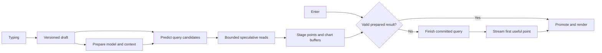

# time-blast

**Research into one loop — natural language → SQL → execute → see it — made so fast that the answer is there the moment you stop thinking about what you want.**

Two questions drive everything:

1. **How fast can the loop get?** Every stage counts: typing, transport, inference, SQL, execution, data movement, drawing. We chase microseconds for their own sake, and measure every claim.
2. **What new data interactions does that speed enable?** Results on every keystroke, anticipating the next question, the chart itself as a query, voice.

The metric is **thought → correct result**. Typing and Enter are steps to shrink or remove. We design for inference ~10× faster than today, when database, transport and drawing will dominate. The engine is generic: any schema, and the model writes SQL directly. One uniform protocol lets inference, database and coordinator each run in the browser or remotely without rewriting anything.

**→ Read [docs/vision.md](docs/vision.md) first.** It is canonical. [docs/README.md](docs/README.md) says which other docs are current.

## Where the code is today

**Batch 1 (2026-10-10) replaced the prototype's architecture on `main`.** The model writes SQL;
every component speaks one binary protocol, [tb1](docs/protocol-v1.md). Plan and progress:
[plan-batch-1.md](docs/plan-batch-1.md), per-area notes in [docs/batch-1/](docs/batch-1/).

| Piece | Where | State |
| --- | --- | --- |
| tb1 frame codec, TS + Rust, golden vectors | `src/protocol/`, `crates/tb-protocol/` | implemented, cross-tested |
| Coordinator (drafts, per-keystroke translation, epochs, stale-result fencing, latency dial) | `crates/tb-coordinator/` → `public/wasm/tb-coordinator.wasm`, loader `src/engine/coordinator.ts` | implemented, native + Wasm tests |
| Engine worker, links, DuckDB-Wasm database node (read-only guard, limits, Arrow streaming, Parquet/CSV drop) | `src/engine/` | implemented, Node tests + headless smoke |
| Inference server on tb1 writing SQL (OpenRouter) | `crates/inference-server/` | implemented, tested, **not deployed** |
| WebLLM inference node on tb1 | `src/inference-node/` | implemented, tested against a fake engine only |
| Main-thread UI | `src/ui/app.ts` (+ modules it imports) | implemented, tested against a fake engine |
| Rust/Wasm renderer (WebGPU/WebGL2) | `crates/tb-render/`, `src/engine/render/` | **in progress, not merged**: `main` has a stub |
| NL→SQL eval by executed results | `evals/`, `scripts/eval-sql.mjs` | implemented; [results](docs/batch-1/evals.md) |

Because the renderer is not merged, **the new loop does not yet draw in a browser end to end.**
The [public demo](https://time-blast.46-224-133-201.sslip.io) still runs the prototype build
(7-field plan, Canvas2D), whose source was removed from `main` in the batch-1 cleanup (last at
`1afe91c`). See [docs/status.md](docs/status.md).

The `vessels` fixture is generated inside DuckDB: `telemetry(ts, vessel, speed, wind,
wave_height, water_temp, lat, lon)`, 1,209,600 rows (six vessels, every 6 s, 1–14 Sept 2026).
`public/data/telemetry.parquet` is the smaller 120,960-row variant (`vessels-small`).

## Run it

```sh
CI=true pnpm install --frozen-lockfile
pnpm dev            # http://localhost:5173, cross-origin isolated
```

Node 22.12+ (or 20.19+). The checked-in Wasm (`public/wasm/`) means Rust is not needed to run
the app. Without `VITE_INFERENCE_ENDPOINT` the UI boots WebLLM (needs WebGPU); set it to a tb1
endpoint (`ws://127.0.0.1:8787/session`) to use the Rust server — see
[docs/batch-1/inference.md](docs/batch-1/inference.md) for its environment.

## Verify or rebuild

```sh
npx tsc --noEmit && pnpm test && pnpm build
cargo test --locked                                                   # workspace: tb-protocol, tb-coordinator, tb-render
cargo test --locked --manifest-path crates/inference-server/Cargo.toml
pnpm build:wasm      # rebuilds tb-coordinator and tb-render into public/wasm/ (needs wasm32-unknown-unknown)
node scripts/eval-sql.mjs --self-test                                 # eval scorer, full corpus, no tokens
# Live NL→SQL eval (spends provider tokens; server running locally):
node scripts/eval-sql.mjs --endpoint ws://127.0.0.1:8787/session
# Browser smokes (Vite dev server + Python Playwright):
python3 tests/engine_smoke.py   # see docs/batch-1/engine.md
python3 tests/ui_smoke.py       # see docs/batch-1/ui.md
```

Remaining legacy: `src/ui/chart.ts` (+ `bar-layout.ts`, `frame-work.ts`, `order.ts`, a trimmed
`src/core/types.ts`) stays only as the Canvas2D baseline for the renderer benchmark; delete it with
that benchmark.

## The central idea

Enter should commit a prepared computation, wherever possible.

While the user types, we can already transmit draft revisions, identify relevant schema, warm a connection and model, reuse a stable prompt prefix, predict likely query plans, and execute bounded speculative reads. A matching result can already be sitting in browser memory when Enter arrives.

The most aggressive path even prepares a hidden chart buffer before submission. Enter validates its identity and reveals it at the next rendering opportunity. A miss falls back immediately to the committed request; speculative work must not delay it.



This moves work earlier; it does not make that work free. Report speculative GPU time, scanned bytes, energy, and hit rate alongside latency.

## What counts as fast

The goal is **thought → correct result** ([vision](docs/vision.md)). The prototype's measured target is the narrower **Enter to the first visible correct point for the committed request**. Also measure first provisional preview, first useful chart coverage, and final exact completion. A wrong prediction, spinner, timestamp without a value, or stale chart is not a successful first point.

There are two measurement levels:

- Software: input event to receiving a valid point and submitting its draw. These are useful proxies, not photon measurements.
- Physical: a triggered key event to light emitted by the corresponding chart region, measured with external equipment.

The display is part of the system. At 60 Hz, nominal frame spacing is 16.67 ms; at 144 Hz it is 6.94 ms. Saving microseconds matters when it prevents missing a frame deadline, but does not guarantee an equal improvement at the eye. Browser rendering is scheduled around rendering opportunities. [HTML rendering model](https://html.spec.whatwg.org/multipage/webappapis.html#update-the-rendering).

## Building blocks

| Block | Initial direction | Aggressive experiments |
| --- | --- | --- |
| Input | Versioned draft snapshots while typing; reliable Enter commit | Incremental patches, locally predicted completions |
| Coordinator | Rust/Wasm sans-IO state machine in the engine worker; explicit identities | Same core as a native service |
| Inference | Pluggable local and remote engines; warm stable context | Prefix reuse, forkable KV state, small constrained query model |
| Query | Model writes SQL; read-only guard, limits and cancellation at execution | Translation cache, SQL dedup, speculative execution per keystroke |
| Database | DuckDB-Wasm prototype; ClickHouse primary deployment target | Ordered scans, aggregate tiles, cached prefixes, narrow first-window reads |
| Data stream | Reliable schema plus incremental columnar batches | A tiny first-point frame followed by bulk Arrow batches |
| Transport | tb1 frames: in-process, MessagePort with transfer, binary WebSocket | WebTransport; shared-memory UI→engine ring |
| Rendering | Rust/Wasm core, WebGPU (WebGL2 fallback) on OffscreenCanvas (in progress) | Pre-rendered speculative buffers |
| Measurement | Local monotonic spans and correctness oracle | Browser traces plus hardware input-to-light measurement |

These are benchmark candidates, not claims that one language, transport, or GPU API is universally fastest. See the referenced design notes for runtime limitations.

## Read the design

Current behavior: [status](docs/status.md), [protocol-v1](docs/protocol-v1.md), [docs/batch-1/](docs/batch-1/). The following documents predate the vision and preserve the broader design; [docs/README.md](docs/README.md) says which still hold.

1. [Architecture](docs/architecture.md): critical paths, placement, identities, and initial decisions.
2. [Protocol draft](docs/protocol.md): drafts, commit, promotion, streaming points, cancellation, and recovery.
3. [Inference](docs/inference.md): preparing models while typing and making speculation useful.
4. [Data plane](docs/data-plane.md): getting an early point from DuckDB and ClickHouse without changing its meaning.
5. [Browser and transport](docs/browser-and-transport.md): networking, memory movement, rendering, and browser limits.
6. [Experiments](docs/experiments.md): latency definitions, trace design, benchmark matrix, and falsifiable tests.
7. [Roadmap and optimization backlog](docs/roadmap.md): what to build first and how far to push it.

The first prototype has a [three-agent review](docs/reviews/README.md) (historical).

Supporting research notes describe the implementation choices and further experiments:

- [Streaming without repacking](docs/streaming-without-repacking.md): database buffers through to first drawing, ownership, and the first-batch barrier.
- [Rust and WebAssembly](docs/rust-and-wasm.md): where compiled kernels help, where bindings add copies, and what to compare.
- [Rust service and channels](docs/rust-service-and-channels.md): browser TCP limits, socket libraries, WebSocket/WebTransport, and ClickHouse relay design.
- [Canvas reference](docs/canvas-reference.md): source-based findings from the existing prototype and interactions to preserve.

## Next experiments

See [the priorities in docs/status.md](docs/status.md#pick-up-here-next).
