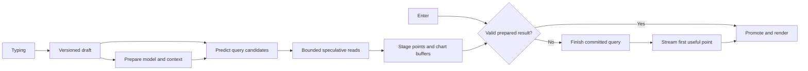

# time-blast

**Minimize the time between pressing Enter on a natural-language data request and seeing its first correct data point.**

Type a question. An LLM turns it into a query. DuckDB or ClickHouse executes it. A chart starts drawing as soon as it has a usable point. Spend the time *before* Enter preparing as much of that path as possible, and ruthlessly shorten whatever remains afterward.

The application runs in the browser. Inference and database execution can each run locally or remotely. A local WebGPU model and DuckDB-Wasm should fit the same execution model as a hosted model and remote ClickHouse. Placement changes the adapter and the latency profile, not the meaning of a request or result.

**Deployment direction:** embedded DuckDB-Wasm for the first prototype; ClickHouse as the primary intended backend, with a Rust service as the leading coordination/relay candidate. The interface is a spatial canvas of maps, charts, tables, and photos beside chat, inspired by [Data Canvas](https://github.com/comino/clickhouse-data-canvas).

**Data-path requirement:** stream columnar buffers all the way into the chart, draw on the first complete timestamp/value point, and eliminate every avoidable copy. No full-result collection, per-row object conversion, or whole-workspace save may gate the first mark. Account explicitly for engine, browser, and GPU boundaries that still require copying.

**Status:** research and architecture repository. No application, protocol implementation, or measured performance results yet. The choices below are proposals to test. Capability references checked on October 9, 2026; pin actual versions when implementing.

## The central idea

Enter should commit a prepared computation, wherever possible.

While the user types, we can already transmit draft revisions, identify relevant schema, warm a connection and model, reuse a stable prompt prefix, predict likely query plans, and execute bounded speculative reads. A matching result can already be sitting in browser memory when Enter arrives.

The most aggressive path even prepares a hidden chart buffer before submission. Enter validates its identity and reveals it at the next rendering opportunity. A miss falls back immediately to the committed request; speculative work must not delay it.

This moves work earlier; it does not make that work free. Report speculative GPU time, scanned bytes, energy, and hit rate alongside latency.

## What counts as fast

The primary target is **Enter to the first visible correct point for the committed request**. Also measure first provisional preview, first useful chart coverage, and final exact completion. A wrong prediction, spinner, timestamp without a value, or stale chart is not a successful first point.

There are two measurement levels:

- Software: input event to receiving a valid point and submitting its draw. These are useful proxies, not photon measurements.
- Physical: a triggered key event to light emitted by the corresponding chart region, measured with external equipment.

The display is part of the system. At 60 Hz, nominal frame spacing is 16.67 ms; at 144 Hz it is 6.94 ms. Saving microseconds matters when it prevents missing a frame deadline, but does not guarantee an equal improvement at the eye. Browser rendering is scheduled around rendering opportunities. [HTML rendering model](https://html.spec.whatwg.org/multipage/webappapis.html#update-the-rendering).

## Building blocks

| Block | Initial direction | Aggressive experiments |
| --- | --- | --- |
| Input | Versioned draft snapshots while typing; reliable Enter commit | Incremental patches, locally predicted completions |
| Coordinator | Thin browser shell; native Rust service candidate; explicit identities | Shared Rust/Wasm state and kernels where they reduce total work |
| Inference | Pluggable local and remote engines; warm stable context | Prefix reuse, forkable KV state, small constrained query model |
| Query planning | Compact query representation compiled to dialect-specific SQL | Prepared templates that bypass generation when interpretation is unambiguous |
| Database | DuckDB-Wasm prototype; ClickHouse primary deployment target | Ordered scans, aggregate tiles, cached prefixes, narrow first-window reads |
| Data stream | Reliable schema plus incremental columnar batches | A tiny first-point frame followed by bulk Arrow batches |
| Transport | In-process calls or worker messages locally; persistent WebSocket remotely | WebTransport streams and supersedable draft datagrams where supported |
| Rendering | Prebuilt chart scaffold and direct Canvas 2D point drawing | OffscreenCanvas, WebGL/WebGPU, pre-rendered speculative buffers |
| Measurement | Local monotonic spans and correctness oracle | Browser traces plus hardware input-to-light measurement |

These are benchmark candidates, not claims that one language, transport, or GPU API is universally fastest. See the referenced design notes for runtime limitations.

## Read the design

1. [Architecture](docs/architecture.md): critical paths, placement, identities, and initial decisions.
2. [Protocol draft](docs/protocol.md): drafts, commit, promotion, streaming points, cancellation, and recovery.
3. [Inference](docs/inference.md): preparing models while typing and making speculation useful.
4. [Data plane](docs/data-plane.md): getting an early point from DuckDB and ClickHouse without changing its meaning.
5. [Browser and transport](docs/browser-and-transport.md): networking, memory movement, rendering, and browser limits.
6. [Experiments](docs/experiments.md): latency definitions, trace design, benchmark matrix, and falsifiable tests.
7. [Roadmap and optimization backlog](docs/roadmap.md): what to build first and how far to push it.

The next research pass develops the implementation choices:

- [Streaming without repacking](docs/streaming-without-repacking.md): database buffers through to first drawing, ownership, and the first-batch barrier.
- [Rust and WebAssembly](docs/rust-and-wasm.md): where compiled kernels help, where bindings add copies, and what to compare.
- [Rust service and channels](docs/rust-service-and-channels.md): browser TCP limits, socket libraries, WebSocket/WebTransport, and ClickHouse relay design.
- [Canvas reference](docs/canvas-reference.md): source-based findings from the existing prototype and interactions to preserve.

## First thing to build

A controlled latency rig: an input box, a deterministic query adapter, a generated time series, and a canvas that draws one point. Trace every boundary. Prove the incremental ownership/rendering contract with embedded DuckDB-Wasm, then carry it into a Rust service streaming ClickHouse. Add inference and replay identical typing sessions through speculation on and off. Keep the order of individual spikes flexible; no application build begins during the current idea-gathering phase.

The first milestone is an honest latency distribution and a correct cancellation/promotion model. The next is a query whose result is ready before Enter. After that, optimize every remaining queue, copy, allocation, batch, and missed frame supported by the measurements.
