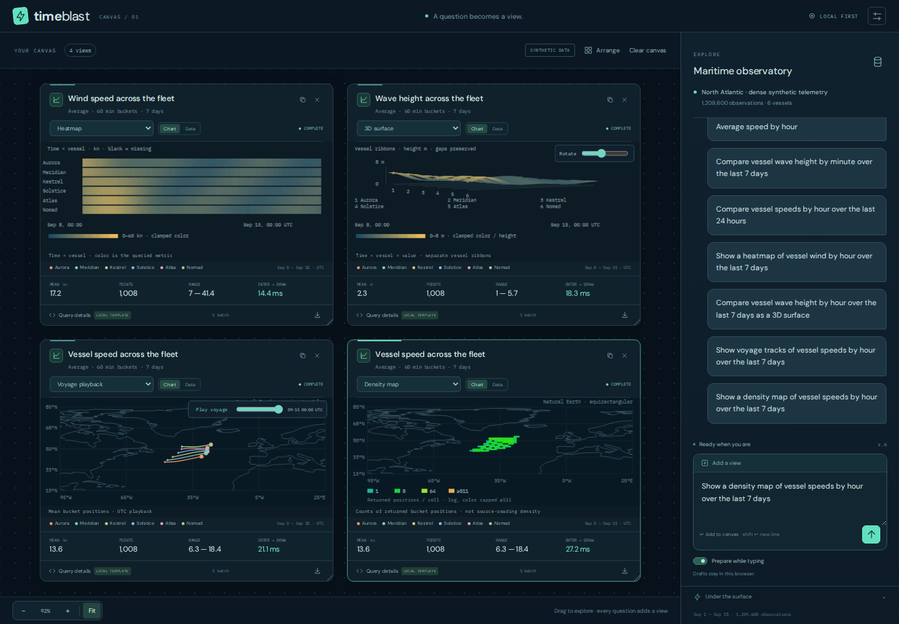
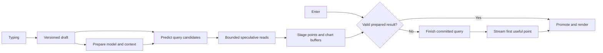

# time-blast

**Minimize the time between pressing Enter on a natural-language data request and seeing its first correct data point.**

Type a question. An LLM turns it into a query. DuckDB or ClickHouse executes it. A chart starts drawing as soon as it has a usable point. Spend the time *before* Enter preparing as much of that path as possible, and ruthlessly shorten whatever remains afterward.

The application runs in the browser. Inference and database execution can each run locally or remotely. A local WebGPU model and DuckDB-Wasm should fit the same execution model as a hosted model and remote ClickHouse. Placement changes the adapter and the latency profile, not the meaning of a request or result.

**Deployment direction:** embedded DuckDB-Wasm for the first prototype; ClickHouse as the primary intended backend, with a Rust service as the leading coordination/relay candidate. The interface is a spatial canvas of maps, charts, tables, and photos beside chat, inspired by [Data Canvas](https://github.com/comino/clickhouse-data-canvas).

**Data-path requirement:** stream columnar buffers all the way into the chart, draw on the first complete timestamp/value point, and eliminate every avoidable copy. No full-result collection, per-row object conversion, or whole-workspace save may gate the first mark. Account explicitly for engine, browser, and GPU boundaries that still require copying.

**Status:** working browser prototype. Embedded DuckDB-Wasm, a Rust/Wasm query compiler, real WebLLM inference, draft transport, speculative execution, and streaming canvas charts are implemented. Remote adapters and their contracts are included; remote services and ClickHouse execution are the next milestone. The design notes below also contain experiments that are not implemented yet.

## Run it

Open the [live browser prototype](https://time-blast.46-224-133-201.sslip.io).
The public demo uses synthetic data; the source repository remains private.
HTTPS hosting and repeatable deployment are described in [deploy/README.md](deploy/README.md).

```sh
pnpm install --frozen-lockfile
pnpm dev
```

Open the printed localhost URL. Use Node 22.12+ (or Node 20.19+). The checked-in Wasm compiler and synthetic Parquet dataset make Rust/Python unnecessary to run the app.

The app generates **1,209,600 synthetic vessel readings** directly inside DuckDB: six vessels, every six seconds, for 14 days. Runtime → Browser dataset also offers the smaller **120,960-reading** Parquet demo. Source row counts and chart point counts are different: aggregation deliberately reduces the latter.

Try **“Compare vessel wave height by minute over the last 7 days”** for **60,480 chart points**, or **“Compare vessel speeds by minute over the last 24 hours”** for **8,640**. Wait for the preparation indicator, then press Enter. The chart reports measured commit-to-first-draw submission, whether prepared data was reused, and the actual point/batch count. Query details expose the generated SQL. This measures software, not photons.

Ask for the presentation directly: **“Show a heatmap of vessel wind by hour over the last 7 days”**, **“Compare vessel wave height by hour over the last 7 days as a 3D surface”**, or **“Show voyage tracks of vessel speeds by hour over the last 7 days”**. Rotate surfaces and scrub or play voyages inside their cards. All ten supported view types are part of the validated inference intent.

Auto inference uses conservative exact templates for recognized requests and a local **Qwen2.5-0.5B** WebGPU model for other wording. Select **Local language model · WebGPU** in Runtime to force real inference even for a template. Initial model download is hundreds of megabytes; loading and model availability are visible. Unsupported WebGPU leaves exact templates usable in Auto mode. Templates are explicitly identified as templates, never presented as model output.

Try “Average speed by hour”, “Maximum wind by hour”, or “Show wave height over the last 7 days”. The narrow intent supports four metrics, avg/min/max, fixed time buckets, trailing windows up to 14 days, and vessel filtering/grouping. Model output is validated and compiled from allowlisted fields; arbitrary generated SQL is never executed. A valid plan can still misunderstand natural language—inspect its meaning before relying on it.

Default execution stays in your browser. Assets and model weights must download initially; offline-first installation is not implemented. Runtime settings independently select browser or remote coordination, inference, and database adapters. They require services implementing [the prototype contracts](docs/prototype.md); entering an OpenRouter or ClickHouse URL directly does not provide those contracts. No remote API keys are bundled or stored.



## What is implemented

- Every input revision crosses a local MessageChannel immediately, then reaches the inference worker. A complete immutable snapshot accompanies Enter.
- After a 180 ms typing pause, one bounded speculative job resolves the current draft and may query DuckDB. Matching work is promoted without executing it again; stale work is canceled. This predicts the current draft, not future words.
- Optionally enable **Runtime → Translate on every edit**, starting at **20 characters** by default. Each eligible edit replaces the previous translation immediately, including deletion/paste; IME composition waits until completion. The threshold is adjustable. Turn **Prepare query results while I type** off to prepare SQL only, then execute the database on Enter. The selected inference mode still applies: Auto may use templates, while Local WebGPU forces the language model.
- Rust/Wasm compiles the intent; DuckDB runs in its own worker; WebLLM runs in another worker. Heavy engines are initialized before submission where possible.
- Arrow numeric columns retain their backing buffers into Canvas2D. The first marker is submitted on the first batch before subsequent chart work. Local data does not get encoded for a fictitious network boundary.
- Cancellation epochs, exact question/snapshot matching, per-query database connections, bounded queues, staged-memory limits, and explicit failure/completion protect speculation.
- Every submitted question immediately adds a loading card to a dotted spatial canvas beside chat. Earlier results stay available; drag and resize cards, pan/zoom, or use Fit and Arrange.
- Ten views: time series, bars, scatter, heatmap, rotatable 3D vessel surfaces, geographic maps, density maps, voyage playback, a seasonal wheel, and a small table. Compatible view changes and duplication reuse the existing column buffers without another query. Cards expose SQL, CSV export, and measured draw submission; the chat rail includes an event trace.
- New renderer code loads on demand and warms while matching chart words are typed. Geographic points do not wait for the bundled coastline. Surface geometry and all returned samples draw in bounded frame slices; no full-result matrix or vertex copy is required.
- Hidden cards skip geometry drawing. The workspace retains up to eight cards and 64 MiB of unique result buffers, removing older views when necessary; it lives in memory for the current page session.

Geographic views require vessel grouping and show mean coordinates per returned bucket. Density counts those positions, not source readings. The seasonal wheel plots actual UTC calendar samples; this 14-day dataset cannot establish annual patterns. Surfaces use separate vessel ribbons rather than interpolating between categorical vessel IDs. Photo galleries remain unavailable because this dataset has no image URLs.

The current aggregation uses `GROUP BY` and `ORDER BY`: database work may finish before its first result batch becomes available. The renderer consumes batches incrementally, but it cannot make a blocking SQL operator produce a final point early. The next substantial latency improvement is an ordered/time-tiled query path. Likewise, no browser can promise literal end-to-end zero-copy through DuckDB's worker/IPC boundary. See [implementation, limits, and copy accounting](docs/prototype.md).

## Verify or rebuild

```sh
pnpm test
pnpm build
# Only when changing the Rust compiler:
rustup target add wasm32-unknown-unknown
pnpm build:wasm
cargo test --manifest-path crates/query-core/Cargo.toml
# With Vite running and Python Playwright + Chromium available:
python3 tests/browser_database.py
python3 tests/browser_database.py --dataset-profile large
python3 tests/browser_ui.py
python3 tests/browser_workspace.py
python3 tests/browser_views.py
python3 tests/ui_live_translation.py
# Requires a real available WebGPU adapter; downloads model weights:
python3 tests/browser_inference.py
```

`pnpm-lock.yaml` pins the JavaScript runtime dependencies. `scripts/generate-dataset.py` records how to regenerate the deterministic input. Tests cover buffer identity, streaming termination, cancellation races, promotion, intent validation, and actual compiled Wasm.

Initial [warm template benchmark](docs/benchmark-browser.json), 20 trials per mode: median commit-to-draw submission **19.6 ms without speculation**, **5.65 ms for a prepared hit**. The latter waits for staging before Enter. This is a small headless-browser experiment, not an inference or photon benchmark; [method and limitations](docs/verification.md).

**Verification limit:** the development host's normal Chromium has no WebGPU adapter. An explicit software-WebGPU run loaded real Qwen weights but timed out after 420 seconds without completing a generated plan. DuckDB, templates, the production build, and rendering were browser-tested; a completed hardware-WebGPU inference still needs verification on a GPU-equipped device. See [verification notes](docs/verification.md).

## The central idea

Enter should commit a prepared computation, wherever possible.

While the user types, we can already transmit draft revisions, identify relevant schema, warm a connection and model, reuse a stable prompt prefix, predict likely query plans, and execute bounded speculative reads. A matching result can already be sitting in browser memory when Enter arrives.

The most aggressive path even prepares a hidden chart buffer before submission. Enter validates its identity and reveals it at the next rendering opportunity. A miss falls back immediately to the committed request; speculative work must not delay it.



This moves work earlier; it does not make that work free. Report speculative GPU time, scanned bytes, energy, and hit rate alongside latency.

## What counts as fast

The primary target is **Enter to the first visible correct point for the committed request**. Also measure first provisional preview, first useful chart coverage, and final exact completion. A wrong prediction, spinner, timestamp without a value, or stale chart is not a successful first point.

There are two measurement levels:

- Software: input event to receiving a valid point and submitting its draw. These are useful proxies, not photon measurements.
- Physical: a triggered key event to light emitted by the corresponding chart region, measured with external equipment.

The display is part of the system. At 60 Hz, nominal frame spacing is 16.67 ms; at 144 Hz it is 6.94 ms. Saving microseconds matters when it prevents missing a frame deadline, but does not guarantee an equal improvement at the eye. Browser rendering is scheduled around rendering opportunities. [HTML rendering model](https://html.spec.whatwg.org/multipage/webappapis.html#update-the-rendering).

## Building blocks

| Block | Initial direction | Aggressive experiments |
| --- | --- | --- |
| Input | Versioned draft snapshots while typing; reliable Enter commit | Incremental patches, locally predicted completions |
| Coordinator | Thin browser shell; native Rust service candidate; explicit identities | Shared Rust/Wasm state and kernels where they reduce total work |
| Inference | Pluggable local and remote engines; warm stable context | Prefix reuse, forkable KV state, small constrained query model |
| Query planning | Compact query representation compiled to dialect-specific SQL | Prepared templates that bypass generation when interpretation is unambiguous |
| Database | DuckDB-Wasm prototype; ClickHouse primary deployment target | Ordered scans, aggregate tiles, cached prefixes, narrow first-window reads |
| Data stream | Reliable schema plus incremental columnar batches | A tiny first-point frame followed by bulk Arrow batches |
| Transport | In-process calls or worker messages locally; persistent WebSocket remotely | WebTransport streams and supersedable draft datagrams where supported |
| Rendering | Prebuilt chart scaffold and direct Canvas 2D point drawing | OffscreenCanvas, WebGL/WebGPU, pre-rendered speculative buffers |
| Measurement | Local monotonic spans and correctness oracle | Browser traces plus hardware input-to-light measurement |

These are benchmark candidates, not claims that one language, transport, or GPU API is universally fastest. See the referenced design notes for runtime limitations.

## Read the design

1. [Architecture](docs/architecture.md): critical paths, placement, identities, and initial decisions.
2. [Protocol draft](docs/protocol.md): drafts, commit, promotion, streaming points, cancellation, and recovery.
3. [Inference](docs/inference.md): preparing models while typing and making speculation useful.
4. [Data plane](docs/data-plane.md): getting an early point from DuckDB and ClickHouse without changing its meaning.
5. [Browser and transport](docs/browser-and-transport.md): networking, memory movement, rendering, and browser limits.
6. [Experiments](docs/experiments.md): latency definitions, trace design, benchmark matrix, and falsifiable tests.
7. [Roadmap and optimization backlog](docs/roadmap.md): what to build first and how far to push it.

The implemented prototype also has a [three-agent performance and correctness review](docs/reviews/README.md), with reproduced failures, regression checks, and explicit remaining limits.

The next research pass develops the implementation choices:

- [Streaming without repacking](docs/streaming-without-repacking.md): database buffers through to first drawing, ownership, and the first-batch barrier.
- [Rust and WebAssembly](docs/rust-and-wasm.md): where compiled kernels help, where bindings add copies, and what to compare.
- [Rust service and channels](docs/rust-service-and-channels.md): browser TCP limits, socket libraries, WebSocket/WebTransport, and ClickHouse relay design.
- [Canvas reference](docs/canvas-reference.md): source-based findings from the existing prototype and interactions to preserve.

## Next experiments

Extend the browser rig with recorded typing replay and latency distributions, then carry its contracts into a Rust service streaming ClickHouse. Compare speculation on/off and exact-template/local-model/remote-model paths using identical requests. Measure kernel or socket changes before declaring a winner.

The first milestone is an honest latency distribution and a correct cancellation/promotion model. The next is a query whose result is ready before Enter. After that, optimize every remaining queue, copy, allocation, batch, and missed frame supported by the measurements.
