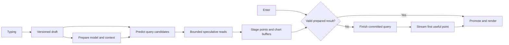

# time-blast

**Research into one loop — natural language → SQL → execute → see it — made so fast that the answer is there the moment you stop thinking about what you want.**

Two questions drive everything:

1. **How fast can the loop get?** Every stage counts: typing, transport, inference, SQL, execution, data movement, drawing. We chase microseconds for their own sake, and measure every claim.
2. **What new data interactions does that speed enable?** Results on every keystroke, anticipating the next question, the chart itself as a query, voice.

The metric is **thought → correct result**. Typing and Enter are steps to shrink or remove. We design for inference ~10× faster than today, when database, transport and drawing will dominate. The engine is generic: any schema, and the model writes SQL directly. One uniform protocol lets inference, database and coordinator each run in the browser or remotely without rewriting anything.

**→ Read [docs/vision.md](docs/vision.md) first.** It is canonical. [docs/README.md](docs/README.md) says which other docs are current.

## Where the code is today

The first prototype (2026-10-09/10) predates the vision. It works and is deployed, but it is narrower than the goal. It uses a 7-field typed plan over one synthetic vessel dataset instead of SQL over any schema, waits 2 s of idle time before live queries, and has a separate JSON protocol per component. The [vision's "unlearn" table](docs/vision.md#what-to-unlearn-from-the-first-prototype) lists what changes. The rest of this README describes the prototype as it exists.

Implemented: browser chat and spatial canvas, DuckDB-Wasm in a worker, a Rust/Wasm query compiler, local WebGPU (WebLLM) or remote inference through a Rust WebSocket service calling OpenRouter, speculative execution with exact-result promotion, and Arrow columns streamed into ten Canvas2D chart types. Remote database and coordinator adapters exist as client contracts without services. **Start here:** [status and handoff](docs/status.md) · [browser contract](docs/prototype.md) · [Rust backend](docs/backend-prototype.md) · [deployment](deploy/README.md).

## Run it

Open the [live browser prototype](https://time-blast.46-224-133-201.sslip.io).
The public demo uses synthetic data; the source repository remains private.
HTTPS hosting and repeatable deployment are described in [deploy/README.md](deploy/README.md).

The deployed demo defaults to **Rust backend inference → OpenRouter → Gemini 2.5 Flash Lite**, with DuckDB and the canvas in your browser. It needs no local model download. One persistent inference socket carries drafts, requests and cancellation. Local WebGPU remains selectable in Runtime settings. See [the service, configuration and verification limits](docs/backend-prototype.md).

A [seven-model hosted comparison](docs/experiments/hosted-models-2026-10-10.md) retained this default: newer and cheaper candidates did not improve its tested combination of exact plans, latency and price. The repeatable benchmark records failures and provider settings; it is a small integration check, not a general model ranking.

```sh
pnpm install --frozen-lockfile
pnpm dev
```

Open the printed localhost URL. Use Node 22.12+ (or Node 20.19+). The checked-in Wasm compiler and synthetic Parquet dataset make Rust/Python unnecessary to run the app.

The app generates **1,209,600 synthetic vessel readings** directly inside DuckDB: six vessels, every six seconds, for 14 days. Runtime → Browser dataset also offers the smaller **120,960-reading** Parquet demo. Source row counts and chart point counts are different: aggregation deliberately reduces the latter.

Try **“Compare vessel wave height by minute over the last 7 days”** for **60,480 chart points**, or **“Compare vessel speeds by minute over the last 24 hours”** for **8,640**. Live query is on by default: once the draft reaches 20 characters, a preview updates after **2 seconds without an edit**. Enter runs immediately, or keeps an existing matching preview without rerunning it. Further edits open a new preview. Each card shows template/model inference time, database time to first batch and completion, data-to-draw time, and run-to-first-draw time. Query details expose SQL, compilation time, and reported inference phases/token counts. These measure software, not photons.

Ask for the presentation directly: **“Show a heatmap of vessel wind by hour over the last 7 days”**, **“Compare vessel wave height by hour over the last 7 days as a 3D surface”**, or **“Show voyage tracks of vessel speeds by hour over the last 7 days”**. Rotate surfaces and scrub or play voyages inside their cards. All ten supported view types are part of the validated inference intent.

Browser-only builds default to **Local language model · WebGPU**, which uses local **Qwen2.5-1.5B with 4-bit weights** and bypasses templates, including for example questions. An unavailable model reports an error instead of falling back to rules. Its weights download is about **0.87 GB**; estimated GPU memory is **1.6 GB with f16**, or **1.9 GB with f32**. Runtime also offers 0.5B and 4B profiles, all with 4-bit weights. The smaller default follows a reported 14-second first run with 4B; it made more interpretation errors than 4B in the [native comparisons](evals/results/README.md). No speedup factor on the user's GPU is established. Changing models preserves the loaded database. For fresh inference trials, turn off **Reuse exact model plans**; this clears cached plans and keeps the model warm.

Auto and template-only modes remain explicit Runtime options. Auto uses conservative exact templates for recognized requests and the model for other wording; templates are labeled explicitly.

Model preparation also warms the selected output grammar with one fixed, non-user token, then clears that conversation. The model becomes ready only after this completes; subsequent questions reuse WebLLM's grammar cache. This moves cold grammar initialization into preparation without hiding its cost: an early question still reports any warmup wait. User token counts and generation statistics exclude the preparation token. Native GGUF tests do not establish browser MLC accuracy or speed.

The local WebGPU adapter and Rust inference service each allow **one correction attempt** if the model refuses, returns an invalid plan, or reaches its output token limit. The model receives its previous response and exact validation error; the correction must pass the same validation. Query details show attempt count, correction time and total work; final failures also show bounded raw model output. Cancellation and transport/runtime errors do not enter this correction loop. This cannot detect every valid plan with the wrong meaning: [hosted comparisons](docs/experiments/hosted-models-2026-10-10.md) and [native evaluations](evals/results/README.md) retain such failures. Native CPU results use different quantization/runtime from the browser and do not establish browser accuracy or latency.

Try “Average speed by hour”, “Maximum wind by hour”, or “Show wave height over the last 7 days”. The narrow intent supports four metrics, avg/min/max, fixed time buckets, trailing windows, and vessel filtering/grouping. A request for 710 days retains that requested window and queries the available overlap: the bundled dataset supplies 14 days, while a remote dataset can supply more. Model output is validated and compiled from allowlisted fields; arbitrary generated SQL is never executed. A valid plan can still misunderstand natural language—inspect its meaning before relying on it.

An ordinary development build defaults to browser execution. A deployment can set `VITE_INFERENCE_ENDPOINT=wss://your-host/api/inference/session` to default to the Rust backend, keeping DuckDB and rendering local. Local model assets must download initially when WebGPU mode is selected; remote inference needs no browser model download. Runtime settings independently select browser or remote coordination, inference, and database adapters. They require services implementing [the prototype contracts](docs/prototype.md); entering an OpenRouter or ClickHouse URL directly does not provide those contracts. Provider API keys stay in the Rust service environment.


## What is implemented

- Input revisions cross a local MessageChannel into the browser coordinator and selected inference adapter. The remote socket coalesces draft snapshots over 25 ms; Enter carries the complete committed text. Live execution and manual submission use the same immutable commit contract across placements.
- **Live query** and **Prepare translation after typing** are enabled by default, starting at **20 characters** after trimming. Automatic inference and queries wait **2 seconds after the latest edit**; draft transport and model warmup remain immediate. Stale work is canceled, IME waits for composition to finish, and readiness preserves the existing deadline. Enter bypasses the pause. Stop, Clear canvas, and closing the live preview cancel pending execution.
- Turn **Live query** off for manual submission with background preparation after the same 2-second pause. With live query off, turn **Prepare query results while I type** off to prepare SQL only and execute the database on Enter. The selected inference mode applies in every case: Auto may use templates, while Local WebGPU uses model-derived plans.
- Qwen3-4B extracts literal quantities, vessel names and requested operations into constrained JSON. Code converts units and checks whether the extracted plan is executable; language interpretation stays with the model. Unsupported aggregate names remain expressible so validation can reject them. The smaller Qwen2.5 profiles retain full query fields, which worked better for them in screening. Every profile uses the same validated query contract downstream.
- A bounded 64-entry exact model-plan cache skips repeated generation within the same adapter/context. It never caches database results or reuses similar wording; hits are labeled. Runtime can disable it for fresh trials without unloading the model. [Historical compact-prompt token counts](docs/benchmarks/inference-token-counts-2026-10-09.json) describe the previous encoding, not the current model-specific formats.
- Rust/Wasm compiles the intent; DuckDB runs in its own worker; WebLLM runs in another worker. Heavy engines are initialized before submission where possible.
- Local DuckDB streams the first complete time bucket, then the remaining buckets in the same read-only snapshot. Both statements share one connection, cancellation and result budget; single-bucket requests use one statement. In a warm paired experiment, the 60,480-point query drew its first points about **42 ms sooner**, adding about **6 ms** to total database time. [Measurements and limits](docs/experiments/first-bucket-query-2026-10-09.md).
- Arrow numeric columns retain their backing buffers into Canvas2D. The first marker is submitted on the first batch before subsequent chart work. Local data does not get encoded for a fictitious network boundary.
- Cancellation epochs, exact question/snapshot matching, per-query database connections, bounded queues, staged-memory limits, and explicit failure/completion protect speculation.
- The live preview and submitted questions immediately display a loading card on a dotted spatial canvas beside chat. Earlier kept results stay available; drag and resize cards, pan/zoom, or use Fit and Arrange.
- Ten views: time series, bars, scatter, heatmap, rotatable 3D vessel surfaces, geographic maps, density maps, voyage playback, a seasonal wheel, and a small table. Compatible view changes and duplication reuse the existing column buffers without another query. Cards expose SQL, CSV export, and measured draw submission; the chat rail includes an event trace.
- New renderer code loads on demand and warms while matching chart words are typed. Geographic points do not wait for the bundled coastline. Surface geometry and all returned samples draw in bounded frame slices; no full-result matrix or vertex copy is required.
- Hidden cards skip geometry drawing. The workspace retains up to eight cards and 64 MiB of unique result buffers, removing older views when necessary; it lives in memory for the current page session.

Geographic views require vessel grouping and show mean coordinates per returned bucket. Density counts those positions, not source readings. The seasonal wheel plots actual UTC calendar samples; this 14-day dataset cannot establish annual patterns. Surfaces use separate vessel ribbons rather than interpolating between categorical vessel IDs. Photo galleries remain unavailable because this dataset has no image URLs.

Aggregation still uses blocking `GROUP BY` and `ORDER BY` within each statement. The local first-bucket path limits that initial work to one complete timestamp; its remaining query streams Arrow batches as they become available. Remote adapters retain their ordinary query contract until they provide equivalent snapshot semantics. No browser can promise literal end-to-end zero-copy through DuckDB's worker/IPC boundary. See [implementation, limits, and copy accounting](docs/prototype.md).

## Verify or rebuild

```sh
# Unit/evaluator parity tests also require Python 3 (standard library only):
pnpm test
pnpm build
# Rust inference service and benchmark scoring; no provider tokens needed:
cargo test --locked --manifest-path crates/inference-server/Cargo.toml
python3 scripts/benchmark-models.py --self-test
# Only when changing the Rust compiler:
rustup target add wasm32-unknown-unknown
pnpm build:wasm
cargo test --manifest-path crates/query-core/Cargo.toml
# With Vite running and Python Playwright + Chromium available:
python3 tests/browser_database.py
python3 tests/browser_database.py --dataset-profile large
python3 tests/browser_ui.py
python3 tests/browser_workspace.py
python3 tests/browser_views.py
python3 tests/ui_live_translation.py
python3 tests/ui_model_profiles.py
python3 tests/browser_model_grammar.py
python3 tests/browser_model_query.py
python3 -m unittest discover -s evals -p 'test_*.py'
# Requires a real available WebGPU adapter; downloads model weights:
python3 tests/browser_model_accuracy.py --profile qwen-1.5b --headed
```

`pnpm-lock.yaml` pins the JavaScript runtime dependencies. `scripts/generate-dataset.py` records how to regenerate the deterministic input. Tests cover buffer identity, streaming termination, cancellation races, promotion, intent validation, and actual compiled Wasm. The [meaning evaluation corpus and runners](evals/README.md) compare every plan field and record unsupported false acceptance separately. Recorded-model replay exercises real SQL/data/rendering; controlled engines and grammar checks do not establish model accuracy.

Initial [warm template benchmark](docs/benchmark-browser.json), 20 trials per mode: median commit-to-draw submission **19.6 ms without speculation**, **5.65 ms for a prepared hit**. The latter waits for staging before Enter. This is a small headless-browser experiment, not an inference or photon benchmark; [method and limitations](docs/verification.md).

**Verification limit:** the development host's normal Chromium has no WebGPU adapter. An explicit software-WebGPU run loaded real Qwen weights but timed out after 420 seconds without completing a generated plan. DuckDB, templates, the production build, and rendering were browser-tested; a completed hardware-WebGPU inference still needs verification on a GPU-equipped device. See [verification notes](docs/verification.md).

## The central idea

Enter should commit a prepared computation, wherever possible.

While the user types, we can already transmit draft revisions, identify relevant schema, warm a connection and model, reuse a stable prompt prefix, predict likely query plans, and execute bounded speculative reads. A matching result can already be sitting in browser memory when Enter arrives.

The most aggressive path even prepares a hidden chart buffer before submission. Enter validates its identity and reveals it at the next rendering opportunity. A miss falls back immediately to the committed request; speculative work must not delay it.



This moves work earlier; it does not make that work free. Report speculative GPU time, scanned bytes, energy, and hit rate alongside latency.

## What counts as fast

The goal is **thought → correct result** ([vision](docs/vision.md)). The prototype's measured target is the narrower **Enter to the first visible correct point for the committed request**. Also measure first provisional preview, first useful chart coverage, and final exact completion. A wrong prediction, spinner, timestamp without a value, or stale chart is not a successful first point.

There are two measurement levels:

- Software: input event to receiving a valid point and submitting its draw. These are useful proxies, not photon measurements.
- Physical: a triggered key event to light emitted by the corresponding chart region, measured with external equipment.

The display is part of the system. At 60 Hz, nominal frame spacing is 16.67 ms; at 144 Hz it is 6.94 ms. Saving microseconds matters when it prevents missing a frame deadline, but does not guarantee an equal improvement at the eye. Browser rendering is scheduled around rendering opportunities. [HTML rendering model](https://html.spec.whatwg.org/multipage/webappapis.html#update-the-rendering).

## Building blocks

| Block | Initial direction | Aggressive experiments |
| --- | --- | --- |
| Input | Versioned draft snapshots while typing; reliable Enter commit | Incremental patches, locally predicted completions |
| Coordinator | Thin browser shell; native Rust service candidate; explicit identities | Shared Rust/Wasm state and kernels where they reduce total work |
| Inference | Pluggable local and remote engines; warm stable context | Prefix reuse, forkable KV state, small constrained query model |
| Query planning | Compact query representation compiled to dialect-specific SQL | Prepared templates that bypass generation when interpretation is unambiguous |
| Database | DuckDB-Wasm prototype; ClickHouse primary deployment target | Ordered scans, aggregate tiles, cached prefixes, narrow first-window reads |
| Data stream | Reliable schema plus incremental columnar batches | A tiny first-point frame followed by bulk Arrow batches |
| Transport | In-process calls or worker messages locally; persistent WebSocket remotely | WebTransport streams and supersedable draft datagrams where supported |
| Rendering | Prebuilt chart scaffold and direct Canvas 2D point drawing | OffscreenCanvas, WebGL/WebGPU, pre-rendered speculative buffers |
| Measurement | Local monotonic spans and correctness oracle | Browser traces plus hardware input-to-light measurement |

These are benchmark candidates, not claims that one language, transport, or GPU API is universally fastest. See the referenced design notes for runtime limitations.

## Read the design

Use the [handoff](docs/status.md), [browser contract](docs/prototype.md), and [backend contract](docs/backend-prototype.md) for current behavior. The following documents preserve the broader design and label unimplemented proposals; their protocol draft is not the shipped inference WebSocket protocol.

1. [Architecture](docs/architecture.md): critical paths, placement, identities, and initial decisions.
2. [Protocol draft](docs/protocol.md): drafts, commit, promotion, streaming points, cancellation, and recovery.
3. [Inference](docs/inference.md): preparing models while typing and making speculation useful.
4. [Data plane](docs/data-plane.md): getting an early point from DuckDB and ClickHouse without changing its meaning.
5. [Browser and transport](docs/browser-and-transport.md): networking, memory movement, rendering, and browser limits.
6. [Experiments](docs/experiments.md): latency definitions, trace design, benchmark matrix, and falsifiable tests.
7. [Roadmap and optimization backlog](docs/roadmap.md): what to build first and how far to push it.

The implemented prototype also has a [three-agent performance and correctness review](docs/reviews/README.md), with reproduced failures, regression checks, and explicit remaining limits.

Supporting research notes describe the implementation choices and further experiments:

- [Streaming without repacking](docs/streaming-without-repacking.md): database buffers through to first drawing, ownership, and the first-batch barrier.
- [Rust and WebAssembly](docs/rust-and-wasm.md): where compiled kernels help, where bindings add copies, and what to compare.
- [Rust service and channels](docs/rust-service-and-channels.md): browser TCP limits, socket libraries, WebSocket/WebTransport, and ClickHouse relay design.
- [Canvas reference](docs/canvas-reference.md): source-based findings from the existing prototype and interactions to preserve.

## Next experiments

See [the priorities in docs/status.md](docs/status.md#pick-up-here-next): unify the protocol, switch to model-written SQL over generic data, remove the idle pause, and measure thought → result stage by stage.
