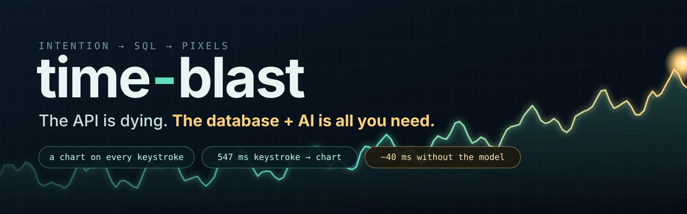
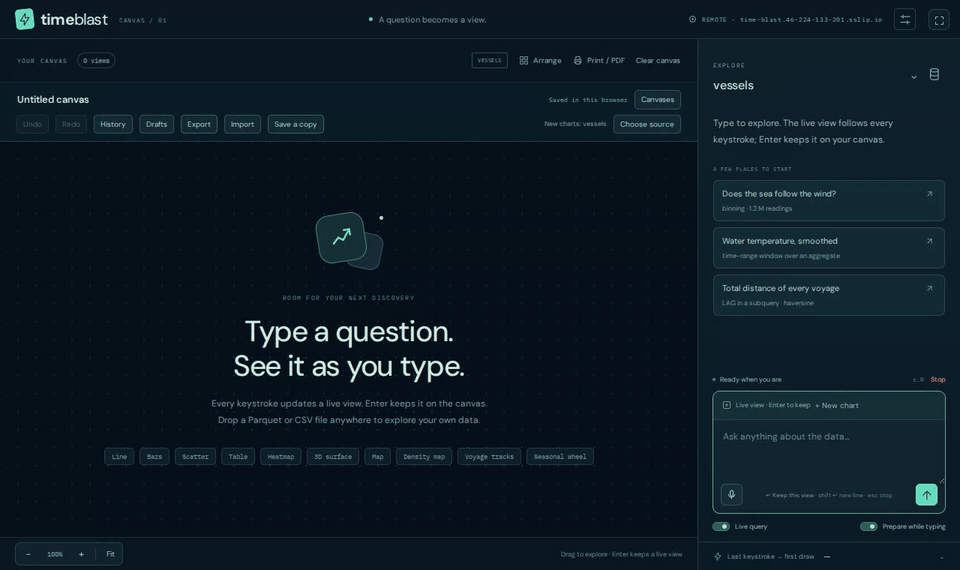
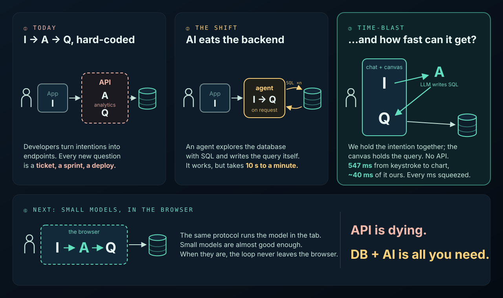

<p align="center">
  <a href="https://time-blast.46-224-133-201.sslip.io"></a>
</p>

<p align="center">
  <b>Ask your data a question. The chart is there before you finish typing.</b><br>
  <a href="https://time-blast.46-224-133-201.sslip.io">Live demo</a> · <a href="docs/vision.md">Vision</a> · <a href="docs/status.md">What's measured</a>
</p>

<p align="center">
  <a href="https://time-blast.46-224-133-201.sslip.io"></a><br>
  <sub>Real time, not sped up: the live demo with hosted inference, recorded in headless Chromium on a software GPU on a 2-core server. The chart follows every keystroke; Enter only keeps it.</sub>
</p>

## The big picture

<p align="center"></p>

Every data app does the same thing: it takes an **intention** (I) from the user, runs it through
**analytics** (A) and sends a **query** (Q) to the database.

1. **Today, I → A → Q is hard-coded.** Developers turn intentions into API endpoints, and every
   new question is a ticket, a sprint and a deploy. The API *is* the frozen translation.
2. **AI eats the backend.** An agent can do the translation at runtime: it explores the database
   with SQL and writes the query itself. It works, but in our agent experiments it takes 10 s to a
   minute per question.
3. **time-blast asks how fast that loop can get, and squeezes every millisecond for its own
   sake.** There is no API. The chat and the canvas hold the intention, the model turns it into
   SQL, and the canvas keeps the query. Only the model and the database are outside the app.
   Measured on the live demo: **547 ms** from last keystroke to chart with hosted inference, of
   which our own pipeline is **~40 ms**.
4. **Next, the model moves into the browser.** The same protocol already runs inference in the
   tab. Small models are close to good enough; once they are, the whole loop is the browser and
   the database.

The API is dying. **The database is all you need.**

## What drives the work

Two questions drive everything:

1. **How fast can the loop get?** Every stage counts: typing, transport, inference, SQL, execution, data movement, drawing. We chase microseconds for their own sake, and measure every claim.
2. **What new data interactions does that speed enable?** Results on every keystroke, anticipating the next question, the chart itself as a query, voice.

The metric is **thought → correct result**. Typing and Enter are steps to shrink or remove. We design for inference ~10× faster than today, when database, transport and drawing will dominate. The engine is generic: any schema, and the model writes SQL directly. One uniform protocol lets inference, database and coordinator each run in the browser or remotely without rewriting anything.

**→ Read [docs/vision.md](docs/vision.md) first.** It is canonical. [docs/README.md](docs/README.md) says which other docs are current.

## Where the code is today

The [live demo](https://time-blast.46-224-133-201.sslip.io) runs `main`. Type a question about
the data; a chart updates on every keystroke. Measured on the public demo: last keystroke →
first draw **547 ms** with real inference (`openai/gpt-oss-120b` on Groq, **91 %** correct on the
45-question executed-result eval). With inference taken out, our own pipeline takes **~40 ms**.
Details and caveats: [docs/status.md](docs/status.md).

```
main thread (JS glue: input, cards, DOM text)
   │ tb1 frames over MessagePort (transferred buffers)
engine worker
   ├─ coordinator  Rust/Wasm, sans-IO: per-keystroke translation, dedup, fencing, cache, latency dial
   ├─ database     DuckDB-Wasm in-process (rollups, result cache, SQL guard) | or tb1 WebSocket → ClickHouse
   ├─ renderer     Rust/Wasm + WebGPU/WebGL2, OffscreenCanvas per card, ten views
   └─ inference    tb1 WebSocket → Rust server → OpenRouter/Groq (writes SQL) | or WebLLM worker
```

| Piece | Where |
| --- | --- |
| tb1 frame codec, TS + Rust, golden vectors ([spec](docs/protocol-v1.md)) | `src/protocol/`, `crates/tb-protocol/` |
| Coordinator | `crates/tb-coordinator/` → `public/wasm/tb-coordinator.wasm` |
| Engine worker, DuckDB-Wasm database node, ClickHouse node | `src/engine/`, `crates/database-server/` |
| Renderer (WebGPU/WebGL2 from Rust/Wasm) | `crates/tb-render/` → `public/wasm/tb-render.wasm`, shim in `src/engine/render/` |
| Inference server (Rust, tb1) and WebLLM node | `crates/inference-server/`, `src/inference-node/` |
| UI: cards, chart-as-query, next-question chips, voice | `src/ui/` |
| NL→SQL eval by executed results | `evals/`, `scripts/eval-sql.mjs` |
| Perf harness, history and dashboard; real-hardware page | `pnpm perf`, [docs/perf/](docs/perf/README.md), `/measure.html` |

The `vessels` fixture is generated inside DuckDB: `telemetry(ts, vessel, speed, wind,
wave_height, water_temp, lat, lon)`, 1,209,600 rows. Any Parquet/CSV file can be dropped onto
the page; nothing on the hot path assumes this schema.

## Run it

```sh
CI=true pnpm install --frozen-lockfile
pnpm dev            # http://localhost:5173, cross-origin isolated
```

Node 22.12+ (or 20.19+). The checked-in Wasm (`public/wasm/`) means Rust is not needed to run
the app. Without `VITE_INFERENCE_ENDPOINT` the UI boots WebLLM (needs WebGPU); set it to a tb1
endpoint (`ws://127.0.0.1:8787/session`) to use the Rust server — see
[docs/batch-1/inference.md](docs/batch-1/inference.md) for its environment.

## Verify or rebuild

```sh
npx tsc --noEmit && pnpm test && pnpm build
cargo test --locked                                                   # workspace: tb-protocol, tb-coordinator, tb-render
cargo test --locked --manifest-path crates/inference-server/Cargo.toml
pnpm build:wasm      # rebuilds tb-coordinator and tb-render into public/wasm/ (needs wasm32-unknown-unknown)
node scripts/eval-sql.mjs --self-test                                 # eval scorer, full corpus, no tokens
# Live NL→SQL eval (spends provider tokens; server running locally):
node scripts/eval-sql.mjs --endpoint ws://127.0.0.1:8787/session
# Browser smokes (Vite dev server + Python Playwright):
python3 tests/engine_smoke.py   # see docs/batch-1/engine.md
python3 tests/ui_smoke.py       # see docs/batch-1/ui.md
```

## The central idea

Don't wait for Enter. Every keystroke is a draft revision: it is translated to SQL, executed and
drawn, with stale work cancelled and stale results fenced out by identity. Identical SQL is
deduplicated, and identical data keeps the chart still, so by the time the user finishes typing
the answer is usually already on screen. Enter only keeps it. After a result settles, likely
follow-up questions are run in the background, so clicking one is a cache hit.

Speculation moves work earlier; it does not make it free. Report inference cost, scanned bytes and
hit rate next to latency.

## What counts as fast

The goal is **thought → correct result** ([vision](docs/vision.md)). The trace headline is last
keystroke → first draw *submitted*; `/measure.html` adds GPU-presented frames on real hardware.
Photons need external equipment. A wrong chart, spinner or stale chart shown early is a failure.

At 60 Hz a frame is 16.67 ms; at 144 Hz 6.94 ms. Saving microseconds matters when it makes a
frame deadline. [HTML rendering model](https://html.spec.whatwg.org/multipage/webappapis.html#update-the-rendering).

## Building blocks

| Block | Initial direction | Aggressive experiments |
| --- | --- | --- |
| Input | Versioned draft snapshots while typing; reliable Enter commit | Incremental patches, locally predicted completions |
| Coordinator | Rust/Wasm sans-IO state machine in the engine worker; explicit identities | Same core as a native service |
| Inference | Pluggable local and remote engines; warm stable context | Prefix reuse, forkable KV state, small constrained query model |
| Query | Model writes SQL; read-only guard, limits and cancellation at execution | Translation cache, SQL dedup, speculative execution per keystroke |
| Database | DuckDB-Wasm prototype; ClickHouse primary deployment target | Ordered scans, aggregate tiles, cached prefixes, narrow first-window reads |
| Data stream | Reliable schema plus incremental columnar batches | A tiny first-point frame followed by bulk Arrow batches |
| Transport | tb1 frames: in-process, MessagePort with transfer, binary WebSocket | WebTransport; shared-memory UI→engine ring |
| Rendering | Rust/Wasm core, WebGPU (WebGL2 fallback) on OffscreenCanvas | Pre-rendered speculative buffers |
| Measurement | Local monotonic spans and correctness oracle | Browser traces plus hardware input-to-light measurement |

These are benchmark candidates, not claims that one language, transport, or GPU API is universally fastest. See the referenced design notes for runtime limitations.

## Read the design

Current behavior: [status](docs/status.md), [protocol-v1](docs/protocol-v1.md), per-batch notes in [docs/batch-1/](docs/batch-1/), [docs/batch-2/](docs/batch-2/), [docs/batch-3/](docs/batch-3/). The following documents predate the vision and preserve the broader design; [docs/README.md](docs/README.md) says which still hold.

1. [Architecture](docs/architecture.md): critical paths, placement, identities, and initial decisions.
2. [Protocol draft](docs/protocol.md): drafts, commit, promotion, streaming points, cancellation, and recovery.
3. [Inference](docs/inference.md): preparing models while typing and making speculation useful.
4. [Data plane](docs/data-plane.md): getting an early point from DuckDB and ClickHouse without changing its meaning.
5. [Browser and transport](docs/browser-and-transport.md): networking, memory movement, rendering, and browser limits.
6. [Experiments](docs/experiments.md): latency definitions, trace design, benchmark matrix, and falsifiable tests.
7. [Roadmap and optimization backlog](docs/roadmap.md): what to build first and how far to push it.

The first prototype has a [three-agent review](docs/reviews/README.md) (historical).

Supporting research notes describe the implementation choices and further experiments:

- [Streaming without repacking](docs/streaming-without-repacking.md): database buffers through to first drawing, ownership, and the first-batch barrier.
- [Rust and WebAssembly](docs/rust-and-wasm.md): where compiled kernels help, where bindings add copies, and what to compare.
- [Rust service and channels](docs/rust-service-and-channels.md): browser TCP limits, socket libraries, WebSocket/WebTransport, and ClickHouse relay design.
- [Canvas reference](docs/canvas-reference.md): source-based findings from the existing prototype and interactions to preserve.

## Next experiments

See [docs/status.md](docs/status.md#next).
