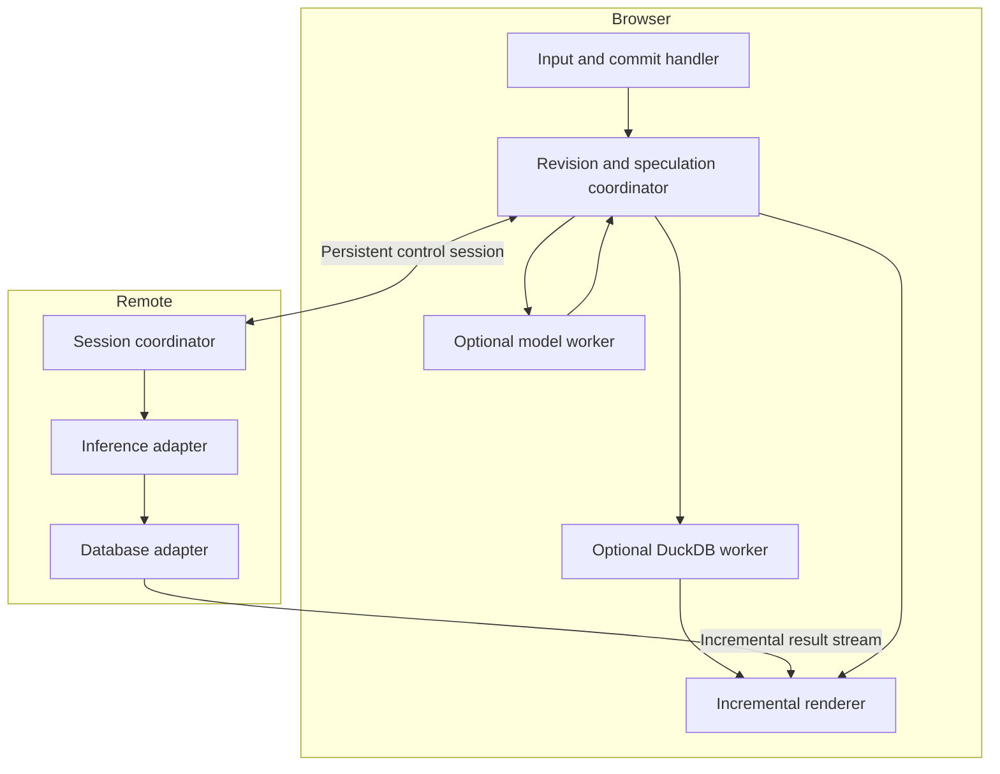

# Architecture

Status: proposed design, October 9, 2026.

Time-blast is a browser application and execution protocol for interactive analytical queries. Its optimization unit is the remaining dependency chain from a committed request to a correct visible point. The system moves independent work before commitment and removes avoidable delays after it.

Embedded DuckDB-Wasm is the first prototype adapter. ClickHouse is the primary intended deployment backend, with a native Rust coordinator/streaming relay as the leading service approach. The canvas is a workspace of views beside chat, not necessarily one rendering surface; see the [reference inspection](canvas-reference.md).

## The latency model

On a cold request, the approximate dependency chain is:

```text
input scheduling
  → connection and session setup
  → relevant schema and prompt construction
  → inference queue + prefill + query generation
  → query validation and planning
  → database queue + execution to first usable output
  → encoding + flushing + delivery
  → decoding + chart update
  → compositor + scanout + pixel response
```

This is a dependency graph, not a sum of independently measured percentiles. Several stages overlap; some disappear on a warm hit. A server-side model can dispatch directly to a nearby database adapter without returning generated SQL through the browser first.

There are four important paths:

| Path | Work remaining after Enter | Main limit |
| --- | --- | --- |
| Valid result staged in browser | Validate promotion, bind chart, draw | Main-thread scheduling and display |
| Valid remote query already running | Deliver remaining first result, draw | Residual execution, network, display |
| Warm context, no valid query | Generate/validate query, execute, stream, draw | Inference and first database output |
| Cold session | Load assets/model/data and establish sessions, then execute | Startup and all dependencies |

Use a separate distribution for each, plus the observed workload-weighted distribution. Never call an in-memory result hit the general query latency.

An illustrative arithmetic example, **not a benchmark**: if a serial warm path spends 120 ms generating a query, 35 ms reaching database output, 12 ms delivering it, and 4 ms preparing its draw, that is 171 ms before display scheduling. Finishing the first three stages before Enter removes those 167 ms from the post-Enter path; a 50 μs parser improvement removes 0.05 ms unless it crosses a frame deadline. We want both improvements, measured at their appropriate scale.

## Components and ownership



The browser owns the submitted revision and the visible chart generation. A coordinator owns candidate admission, priorities, and cancellation. Each adapter owns engine-specific handles. A remote coordinator is optional; no network hop is required between local components.

Use the same logical events across placements. An in-process call does not serialize itself to a network packet merely to satisfy the abstraction. Worker adapters can pass transferable buffers. Remote adapters encode messages. Keep interfaces coarse enough that a data batch does not generate one promise or worker message per point.

Preserve columnar buffers through those boundaries. The chart consumes batch views incrementally and starts at the first complete point; no whole-result materialization, row-object conversion, or workspace serialization belongs in the data path. Preserve upstream encoding in the Rust relay where compatible, and account for every unavoidable copy. Ownership and decoder availability can require a copy or a complete small batch; document that boundary rather than claiming universal zero-copy. See [streaming without repacking](streaming-without-repacking.md).

## Placement combinations

| Inference | Database | Intended path and issue to measure |
| --- | --- | --- |
| Browser | Browser | No request network trip after warmup; CPU, memory, and GPU contention become central |
| Browser | Remote | Generate locally, send validated query remotely; network remains after a prediction miss |
| Remote | Browser | Return query representation to browser, compile and execute locally; avoid shipping local data for inference |
| Remote | Remote | Model/coordinator sends query directly to DB; browser receives results without a SQL round trip |

Remote execution should be placed near the data when it avoids moving large inputs. An edge hop is useful only if its savings exceed the extra queue and hop it introduces. Test actual deployment topology.

## Adapter contracts

These are logical contracts to implement, not APIs promised by existing engines.

| Adapter | Operations | Capabilities to declare |
| --- | --- | --- |
| Inference | `prepare(context)`, `predict(draft)`, `resolve(commit)`, `cancel(candidate)` | Prefix-cache hints, persistent prefill, append, fork, constrained output, cancellation granularity |
| Database | `prepare(plan)`, `execute(query, parameters, consistency)`, `cancel(execution)` | Early batches, ordering, snapshot identity, resumability, point finality, limits |
| Transport | `sendControl`, `openResults`, `cancelStream` | Reliable streams, datagrams, available credits, connection reuse |
| Renderer | `stage`, `activate`, `upsert`, `reset`, `finish` | Supported value types, progressive domains, provisional styling, buffer ownership |

Unsupported optimizations fall back to ordinary inference and query execution. A provider without mutable model sessions still benefits from pre-sent drafts, stable context, early candidate requests, and reusable connections. Capability probes and engine versions belong in benchmark output.

## Identity and promotion

Cache keys and promotion checks bind all inputs that can change meaning:

```text
authenticated principal and authorization epoch
schema and semantic catalog versions
conversation/context version
model/tokenizer/template configuration for cached model state
exact committed text and resolved query interpretation
query parameters, timezone, units, bucket boundaries
database/dataset identity, data epoch or declared freshness policy
chart resolution and aggregation contract
```

Use separate keys for model state, plans, and results: model version need not invalidate a reusable database result if a newly validated query is identical, while a plan key alone cannot validate data freshness. A hash is a lookup accelerator; the authorization check and semantic binding remain authoritative.

An exact draft match permits reusing its accepted interpretation; high prediction confidence is insufficient. It does not prove that the model understood the question. Query validation establishes executable/catalog correctness, while benchmark semantic correctness requires the independent reference interpretation described in the experiments. A predicted completion that differs from the submitted text requires interpretation validation before promotion. An allowed template can prove equivalence for its own small grammar. General natural-language equivalence cannot be inferred from text similarity.

Resolve relative time deliberately. “Last hour” evaluated at speculative start differs from “last hour” evaluated at commitment. The default protocol freezes the coordinator's clock at first commit acceptance; a product requiring the physical Enter-time window can instead submit an explicit client-clock anchor under a declared policy. Either bind the new endpoint and reuse only provably compatible work, or apply an explicit “as of” snapshot/freshness contract. A cached stale result may be a labeled preview; it is not automatically an exact hit.

## Work while typing

1. On workspace/data-source selection, establish scoped sessions and load schema summaries.
2. On input focus, warm available model/context state and the chart scaffold.
3. On `input` events, send bounded versioned text snapshots. Handle paste, selection edits, and IME composition; do not assume keystrokes append ASCII characters.
4. After meaningful changes or an adaptive pause, infer a likely query representation. Keep the stable prefix and discard obsolete suffix work.
5. Admit a small number of bounded speculative reads when confidence, expected savings, and spare capacity justify them.
6. Stage results and optionally render buffers under their candidate identity.
7. On Enter, freeze the request identity, promote compatible work, and prioritize whatever remains.

Start with one speculative candidate per active editor. Keep a dedicated execution lane or reserved capacity for committed work. Scale breadth only when measured hit rate pays for contention and waste. Repeatedly typing, deleting, and retyping must not accumulate unbounded work.

## The chart contract

A usable point needs its timestamp, value, series identity, units, and enough domain information to map it into the chart. A lone timestamp does not meet the goal. Draw a marker even if the chart will later become a line; a one-vertex line can be invisible.

Establish the time window and initial layout before data arrives when the question permits it. An unknown y-domain can use a clearly provisional scale and expand without waiting for the entire series. Distinguish value finality from scale changes. Do not animate the first point into view or wait for legends, tooltips, syntax highlighting, or explanatory prose.

Query binding, point quality, resolution, and coverage are independent. An exact sum for a completed five-minute bucket can arrive before the rest of the chart. A sampled estimate can cover the entire time range without being exact. The protocol carries these distinctions.

## Initial decisions

- Favor native Rust for the service and compare Rust/Wasm kernels with a direct typed-array browser path. Keep the browser event/DOM bridge small and begin first-marker comparisons with a precreated Canvas 2D renderer. Preserve an already usable buffer rather than copying it through Wasm for language uniformity.
- Use a persistent WebSocket control/data baseline remotely and native calls or worker messages locally. Benchmark WebTransport as an optional transport.
- Support Arrow streams first for database interoperability. Compare one-row first batches and a custom first-point frame before standardizing another binary format.
- Separate the user interface framework from the per-batch draw path. Keep transport decoding, chart state, and buffers persistent across requests.
- Make speculative execution and remote draft transmission visible workspace settings. Establish those choices before typing, outside the measured Enter path.
- Enforce an allowed query representation, read-only credentials, object/function restrictions, and execution caps. An LLM-generated `SELECT` is not by itself a safe speculative query.
- Keep credentials at the appropriate boundary: remote engine secrets live on the backend, not in downloadable browser code. Local-only mode can keep drafts and data on device.

See [inference](inference.md), [data plane](data-plane.md), and [browser and transport](browser-and-transport.md) for source-backed capability details. The [protocol](protocol.md) is the shared behavior; the [experiments](experiments.md) decide the implementation.
