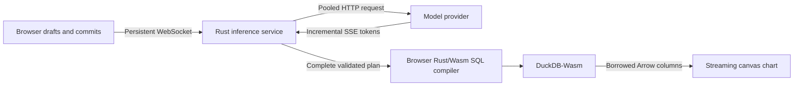

# Rust inference backend prototype

The browser can now keep one WebSocket open to a Rust inference service while
DuckDB and chart rendering remain local. The service calls an OpenAI-compatible
Chat Completions provider directly over a pooled HTTP client and consumes its
SSE response incrementally. It returns a validated query plan; the browser's
Rust/Wasm compiler still produces the SQL. Generated SQL is never accepted from
the provider.

This implements remote inference, not remote database execution or coordination.
The existing browser coordinator still owns the two-second typing pause,
speculation, exact request identities, and rendering. The service is a prototype
with bounded resources; its socket-library choice does not establish that it is
the fastest possible implementation or remove provider inference latency.

## Run locally

Use Rust 1.88 or later. From the repository root:

```sh
cargo build --release --locked --manifest-path crates/inference-server/Cargo.toml
pnpm dev
```

In another terminal, select a provider endpoint and a model that supports strict
JSON-schema output. Keep the API key in the service environment, never in the
browser settings or a committed file. For OpenRouter:

```sh
export TIME_BLAST_PROVIDER_URL=https://openrouter.ai/api/v1/chat/completions
export TIME_BLAST_MODEL=your-provider/model-id
export TIME_BLAST_OPENROUTER=true
read -rsp 'Provider API key: ' TIME_BLAST_API_KEY
export TIME_BLAST_API_KEY
export TIME_BLAST_BIND=127.0.0.1:8787
export TIME_BLAST_ALLOWED_ORIGINS=http://127.0.0.1:5173,http://localhost:5173
./crates/inference-server/target/release/time-blast-inference
```

For a local inference server, set its complete Chat Completions endpoint, its
served model name, and `TIME_BLAST_OPENROUTER=false`. A local endpoint can run
without an API key. Provider compatibility still requires streaming Chat
Completions and support for the requested output schema; this is not a generic
adapter for every model-serving API.

In the browser, open **Runtime settings**, choose **Remote language model**, set
**Inference endpoint URL** to `ws://127.0.0.1:8787/session`, and apply. Leave the
database set to the browser. No browser model download is needed. Ask:

> Compare vessel wave height by minute over the last 7 days

The bundled dense synthetic dataset produces 60,480 chart points when the model
returns that intended plan. Inspect Query details to verify the interpreted SQL,
provider model, token counts when supplied, and timings. A structurally valid
plan can still misunderstand the question.

`GET /health` reports service configuration/readiness without generating model
tokens. An established socket and a ready service do not mean the provider has
warmed model weights, compiled its grammar, or retained a prefix/KV cache.

The default provider is OpenRouter and the configured default model is
`google/gemini-2.5-flash-lite`. This is independent of the browser's optional
1.5B WebGPU model. OpenRouter requests ask for latency-sorted routing and require
support for the request parameters. The backend exposes these environment
controls:

| Setting | Default | Meaning |
| --- | --- | --- |
| `TIME_BLAST_MODEL` | `google/gemini-2.5-flash-lite` | Exact provider model ID. |
| `TIME_BLAST_REASONING_EFFORT` | unset | OpenRouter only: `none`, `minimal`, `low`, `medium`, or `high`. Unset leaves the provider default; `none` requests disabled reasoning where supported. |
| `TIME_BLAST_TEMPERATURE` | `0` | Sampling temperature from 0–2, or `provider` to omit the parameter for models that do not support it. |
| `TIME_BLAST_BIND` | `127.0.0.1:8787` | Listening address. |
| `TIME_BLAST_TIMEOUT_SECONDS` | `25` | Total inference deadline, including one correction; range 1–30 seconds. |
| `TIME_BLAST_MAX_CONCURRENT` | `4` | Concurrent provider operations; excess work is rejected. |
| `TIME_BLAST_REQUESTS_PER_MINUTE` | `30` | Process-wide admission budget for uncached requests. |
| `TIME_BLAST_REQUESTS_PER_DAY` | `1000` | Process-wide daily admission budget for uncached requests. |

One admitted request can use two generations if correction is necessary. These
process-local counters reset on restart; they are bounded prototype protection,
not account-level billing quotas or per-user rate limits.

Reasoning support is model-dependent. Check OpenRouter's model metadata before
setting an effort: a model with mandatory reasoning cannot use `none`, and
`minimal` can still spend tokens thinking. The 256-token completion limit includes
reasoning tokens. Hiding reasoning text does not disable that work. Gemini 3.5
Flash Lite also requires provider-controlled sampling, so comparison runs use
`TIME_BLAST_TEMPERATURE=provider`. These options do not change the default model.

## Data and control paths



The inference socket uses subprotocol `time-blast.inference.v1`. Its bounded
JSON control messages are separate from the columnar database result path.

| Browser message | Purpose |
| --- | --- |
| `HELLO {version:1, context, cachePlans}` | Establish one immutable dataset context for the session. |
| `DRAFT {draft}` | Replace the latest typed revision before submission; does not independently generate tokens. |
| `INFER {id, draft, cachePlans}` | Infer an immutable question using the existing session context. |
| `CANCEL {id}` | Cancel that request and its upstream response stream. |
| `CACHE_POLICY {cachePlans}` | Immediately change plan reuse, clearing and fencing cache entries when disabled. |

| Service message | Purpose |
| --- | --- |
| `READY` | Session accepted. |
| `RESULT {id, result}` | Full validated plan, model identity and available diagnostics. |
| `ERROR {id?, message, ...}` | Explicit failure; no template substitution or partial execution. |

The full context crosses the socket once at `HELLO`, rather than on every
keystroke and every inference. `INFER` still includes the full committed text so
a delayed or superseded draft cannot change its meaning. The provider receives
a stable system prompt containing schema rules and captured dataset metadata.
That enables provider prefix caching where supported; no provider cache hit is
assumed or guaranteed by this prototype.

The HTTP fallback `POST /infer` implements the existing browser contract:

```json
{"text":"Compare vessel speeds by hour","revision":1,"draft":{"revision":1,"text":"Compare vessel speeds by hour","contextId":"dataset-snapshot","sentAt":1},"context":{"id":"dataset-snapshot","label":"Example","rowCount":100,"start":0,"end":86400000,"vessels":["Aurora"],"description":"Synthetic example"},"schema":{}}
```

The service independently owns and validates its output schema; a caller's
`schema` cannot broaden executable operations. HTTP requests include context
again and do not share the WebSocket session's plan cache. `POST /draft` is a
best-effort compatibility endpoint, not a persistent HTTP model session.

## Latency work implemented

- One persistent browser connection using Tokio and `fastwebsockets`; accepted
  TCP connections use `TCP_NODELAY`. The browser networking API still owns its
  side of the connection and TLS is terminated by the deployment proxy.
- One reusable `reqwest` client with connection pooling and HTTP/2 support.
  Provider calls have no intermediate SDK agent loop or MCP hop.
- Incremental SSE decoding with bounded response/event storage. Provider tokens
  can be observed for timing, but only a complete validated plan reaches SQL.
- Stable prompt/schema content for a session, bounded exact plan reuse,
  and cancellation propagated upstream. A cache hit skips model generation and
  reports the hit rather than reusing an old generation duration.
- At most one correction generation after invalid output. The model receives
  its previous response and the validation error. Both attempts must pass the
  same allowlist; transport/runtime errors do not enter a correction loop.
- No server detour for browser-local database columns. The existing first
  complete time bucket and Arrow-to-canvas borrowing are preserved.

Draft transmission alone does not run speculative provider inference. The
existing browser policy starts it after a two-second pause and can promote the
matching prepared SQL or result on Enter. Provider grammar preparation, forked
KV sessions, predictive completions, provider-specific prompt caching controls,
and ClickHouse execution remain separate future experiments.

## Bounds, cancellation, and deployment

The service bounds message sizes, provider output, active sessions, request
admission, per-session in-flight work, deadlines, and exact plan cache entries.
A WebSocket session retains at most 64 exact plans for its captured context and
admits at most two in-flight requests. Disabling plan reuse clears and fences
that session's cache. Disconnecting a client cancels its outstanding work.
Sessions require `HELLO` within ten seconds and a heartbeat response within
75 seconds. These deadlines release capacity held by incomplete handshakes or
unresponsive clients.

Canceling closes the service's provider request/stream; whether the provider
actually stops generation or billing is provider-specific. A closed connection
does not prove that remote GPU work stopped. First-token timing begins at the
service's provider operation and includes network and provider queue time; it
is not isolated GPU prefill time. Browser inference latency additionally
includes the browser/service round trip. Do not subtract clocks from separate
machines, add overlapping spans, or report software draw submission as photons.

The default loopback bind is suitable for local development. For HTTPS browser
deployment use `wss://` behind a TLS reverse proxy, configure the explicit
allowed browser origins, and apply access control/rate policy at the edge.
Origin checks constrain browser access; they are not user authentication.
Provider credentials stay in the process environment. There is no browser API
key field and no direct provider credential forwarding from client messages.

## Reproducible verification

```sh
cargo test --locked --manifest-path crates/inference-server/Cargo.toml
cargo build --locked --manifest-path crates/inference-server/Cargo.toml
pnpm test
pnpm build
# With Vite running; the test starts its own Rust process and mock provider:
python3 tests/browser_remote_backend.py \
  --binary crates/inference-server/target/debug/time-blast-inference
```

`browser_remote_backend.py` exercises real browser WebSocket framing, the
compiled Rust server, a deterministic local HTTP/SSE provider, and actual
DuckDB-Wasm queries/rendering. It checks the two-second live-query pause,
60,480-point output, session/context reuse, reported provider token diagnostics,
exact plan caching, upstream connection cancellation, and absence of WebGPU
model downloads. It also checks the HTTP compatibility endpoint's independent
validation, one correction using the exact validation error, and rejection of
an unlisted browser origin before any provider request. Its fixture timings do not establish real model accuracy,
provider speed, tail latency, public network behavior, or production capacity.

`browser_backend_live.py` instead uses the service's configured real provider
and **spends provider tokens**. It accepts no credentials, disables exact plan
reuse, and checks three full inferred plans against actual SQL, DuckDB point
counts, and chart modes: 60,480 wave points, 8,640 speed points, and a 144-point
3D surface. It exercises Enter and the two-second live-query pause, saving
identified socket responses and card timings atomically after every question.
There is no template or mock fallback in this script:

```sh
python3 tests/browser_backend_live.py \
  --url http://127.0.0.1:5173 --endpoint ws://127.0.0.1:8787/session \
  --output /tmp/time-blast-backend-live.json
```

Omit `--endpoint` to verify that a deployed build already defaults to remote
inference; set `--url` to that deployment. `--screenshot` optionally saves the
completed three-chart canvas. One correction can add a second provider
generation per question. This small correctness smoke reports observations,
not a statistically meaningful latency distribution.

Real provider evaluation must additionally record the exact model/provider,
request schema/prompt, cold/warm state, correction rate, semantic accuracy,
p50/p95/p99 latency, and canceled/speculative work. No “fastest integration” or
microsecond improvement is claimed without that comparison.

The development-host smoke passed on 2026-10-10 with Chromium 145.0.7632.0:
one socket and one context transmission produced 60,480, 144, and 60,480 chart
points, with the last plan served from the backend session cache. The live
`INFER` message followed the input event by 2,008.2 ms, measured within the same
browser monotonic clock. The canceled fixture observed its upstream connection
close; the HTTP correction and origin-rejection checks passed. No browser model
weights were requested and no page errors occurred. The provider in this run
was the local deterministic SSE fixture, not a language model.
