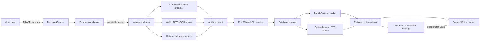

# Browser prototype: implemented contract

This document describes code in this repository. The other design documents explore the broader target, including features this prototype has not implemented.

## Execution and ownership



`src/core/types.ts` defines logical contracts. Their local calls do not require serialization. `main.ts` wires selected placements together and discards events from superseded runtimes. Changing speculation or coordinator placement preserves both warmed adapters. Changing inference preserves the database; changing the database preserves the model and supplies its new context.

`BrowserCoordinator` owns one speculative candidate and one foreground request. An input pause of 180 ms starts speculative work. Enter promotes a matching in-flight or completed candidate, or starts a new job. Identity includes the exact prompt and immutable dataset context, with configuration isolated by the coordinator instance. Only already-staged data counts as a prepared-result hit. An in-flight reuse has a separate trace event. Queued draft/commit messages are fenced by cancellation epochs.

Optional `liveTranslation` changes that trigger to every eligible edit, with no debounce after `translationMinChars` (default 20, after trimming outer spaces). It remains off by default. Composition, shorter input, cancellation and replacement invalidate the old candidate. Native generation has one active task and one removable waiter; canceled warmup waiters are removed immediately. Thus each edit starts a logical request, but a busy model may still need to finish interrupting its prior task before executing the latest one.

With database speculation disabled, live translation stops after validated intent and Rust SQL compilation. The UI reports `SQL prepared before Enter`; Enter reuses that plan/SQL and starts the database, emitting `prepared_sql_promoted`. With database speculation enabled, the candidate may also execute the query and stage results. This policy is independent of model placement, and neither mode performs incremental KV-cache updates.

The model receives draft snapshots immediately in its worker, but those messages do **not** incrementally mutate a KV cache. Generation starts on a speculative pause or committed miss. Warmup downloads/initializes the model; full prepared inference moves the actual prompt evaluation before Enter. The implementation does not yet predict a sentence suffix, fork model caches, or preload every possible result.

Qwen2.5-0.5B-Instruct is selected from WebLLM 0.2.85's pinned model registry. It uses q4f16 when `shader-f16` is exposed and q4f32 otherwise. Generation is deterministic (`temperature: 0`), constrained to a compact JSON schema, and capped at 256 output tokens. A dedicated worker serializes generations and owns cancellation. Partial model output never becomes executable SQL. The exact-template parser refuses unsupported wording, including unsupported filters/negation, instead of silently dropping it. Model semantic accuracy remains a separate evaluation problem.

The Rust compiler has no external dependencies. It accepts numerical/enumerated fields, fixes table/column names, binds the trailing window to the dataset end, and returns one SQL string. JavaScript validates values before integer ABI coercion; Rust validates them again. Results never traverse the compiler's Wasm memory.

## Data plane and first drawing

Two local synthetic profiles cover six fictional vessels for 14 days from 2026-09-01 inclusive to 2026-09-15 exclusive. The default `large` profile evaluates the original continuous-time signal formulas every six seconds inside DuckDB, producing 1,209,600 rows without JavaScript row objects or an additional download. The `demo` profile loads the bundled 120,960-row, one-minute Parquet fixture. They have distinct immutable context IDs. Source formulas and profile metadata are in `src/adapters/synthetic-data.ts`; the original fixture generator and metadata remain in `scripts/generate-dataset.py` and `public/data/context.json`.

DuckDB materializes the selected table at startup under its 256 MiB database memory limit, then disables external access and locks configuration. That setting is not a cap on the browser's entire process. Each query owns its connection. One active query and one waiter bound database admission; cancellation finishes before that query's connection is released. Switching profiles replaces the database and context but preserves the warmed model. Minute-level output yields 60,480 points for a grouped seven-day query; hourly output over one day remains 144 points even on the larger source.

`connection.send(sql, true)` yields Arrow record batches. `retainArrowBatch` verifies primitive contiguous, non-null columns, then returns typed-array views with their Arrow owner retained. Canvas receives those references directly. Unit tests assert backing-buffer identity, including slices. The first complete point is submitted without waiting for query completion. Bulk indexing, statistics, and drawing leave the next animation-frame callback free, then run in bounded slices targeting a shared four-millisecond frame budget. This gives rendering an opportunity; it does not prove physical presentation.

Ordered appends draw only new segments while domains remain unchanged. Rescaling, resizing, or reordering requires a redraw. Track extrema are maintained incrementally; hidden time-series charts retain data without drawing geometry. Reference indexes can be sorted cooperatively without repacking producer columns. At large result sizes, bounded slices trade full-chart completion time for responsiveness; measure useful coverage as well as the first marker.

Database completion and display completion are separate. The UI shows `DRAWING` while primary-chart geometry or statistics remain pending, then `COMPLETE` once that work settles. Database completion timestamps and first-marker timing remain unchanged. Connected lines include every returned point; only the latest point per series gets an endpoint dot. The continuous synthetic signals are deliberately smooth, so denser sampling increases vertices without necessarily changing the apparent curve.

Expected output columns:

| Column | Type | Meaning |
| --- | --- | --- |
| `x` | Float64 | Integer epoch milliseconds in UTC |
| `y` | Float64 | Finite aggregated metric |
| `series` | Int32 | Stable vessel ID; fleet-only aggregation uses 0 |
| `lat`, `lon` | Optional Float64 pair | Mean coordinates for a schematic track |

The track is a visualization of generated coordinates, not a navigation map. Global fleet averages do not represent a physical vessel position. The current SQL sorts by timestamp and series; the chart also handles reordered batches by sorting lightweight indices, without repacking numerical columns.

Copy accounting:

- Production keeps gzip-packaged DuckDB engines (about 8–9 MB each). The public Caddy host supplies `Content-Encoding: gzip`, so fetch receives Wasm decoded by the browser's HTTP stack. The loader assembles a temporary Blob URL for engine startup, then revokes it; this remains a startup allocation. Hosts serving literal compressed bytes instead use the `DecompressionStream` fallback. Query/result buffers never pass through this loader. Development loads the raw local engine asset.
- Parquet decoding, table materialization, DuckDB's Wasm/worker output, and Arrow IPC assembly are engine/browser boundaries, not end-to-end zero-copy guarantees.
- Arrow-to-chart columns are views, retained by reference. No row-object expansion, JSON data conversion, full-table collection, or bulk passage through Rust is on this path.
- Numeric validity checks walk a batch before publication. The chart walks values to draw/scale. Those are reads, not copies, and are profiling candidates.
- The renderer uses Canvas2D commands; browser rasterization/compositing can perform additional internal copies. There is no claim of shared CPU/GPU storage.
- CSV export deliberately allocates text when explicitly requested, after result rendering.

Speculative staging is limited to 4 MiB; foreground data retention to 16 MiB. These budgets charge unique backing allocations, including the full buffer behind a slice and owner validity buffers. Logical payload bytes remain a separate telemetry value. These are data-buffer budgets, not caps on all renderer/index/engine memory. The database adapter independently limits rows and bytes. A budget overflow is an explicit error/discard, never silent truncation. Small demo queries often return one batch. Aggregation and sorting are blocking operators: `send` is an incremental output API, not proof that the first final aggregate appears while the source is still being scanned.

## Remote inference adapter

Configure an HTTP(S) inference endpoint. POST JSON:

```json
{"text":"...","revision":7,"draft":{"revision":7,"text":"...","contextId":"snapshot","sentAt":1234},"context":{},"schema":{}}
```

`context` and `schema` contain the actual dataset and supported model response schema. Return `{"plan":{...},"model":"...","tokens":90}` or a bare valid plan. The browser validates every field. A proxy can call OpenRouter, a self-hosted model, or another provider. Keep credentials at the service. The browser adapter aborts superseded requests, bounds response JSON to 64 KiB, and does not assume the provider has a mutable prefilled session.

An explicitly configured **draft endpoint** receives coalesced POSTs containing `{"type":"DRAFT","draft":{...},"contextId":"..."}`. It is optional; the app never invents a route for an arbitrary inference service. Without it, speculation can still send a full generation request before Enter when enabled. With remote placements, text can therefore leave the browser before submission, as the UI states.

## Remote database adapter

Configure a base HTTP(S) URL:

- `GET {base}/context` returns a validated `DatasetContext` snapshot.
- `POST {base}/query` accepts `{id, sql, plan, context_id, priority}` and returns uncompressed, little-endian Arrow IPC streaming output with the columns above. Other byte orders are rejected rather than copied into swapped buffers.
- Set `X-Time-Blast-Completion: arrow-eos-v1`. Cross-origin servers must expose this header with `Access-Control-Expose-Headers` and permit the origin/methods through CORS.
- **Withhold Arrow's explicit end-of-stream marker until database execution has succeeded.** The browser requires both explicit IPC EOS and clean HTTP completion. On database failure, abort/truncate the response instead of appending a false success marker. Early points remain marked incomplete on failure.
- Return exactly one schema and one stream, with no duplicate/extra columns, dictionary messages, or bytes after EOS. Metadata messages are bounded to 64 KiB. The browser verifies message framing before passing the original result chunks into Arrow; only fragmented metadata needs a bounded assembly buffer. The success marker is the modern eight-byte Arrow EOS at a message boundary.
- Priority is read at admission. A request already sent as speculative has no remote priority-upgrade operation in this contract yet.

This is a bridge contract, not the raw ClickHouse HTTP interface. The service must independently validate the intent/SQL, permissions, context freshness and resource budgets. A browser is not an authorization boundary. A future Rust/ClickHouse bridge should preserve Arrow buffers where formats match and supply ordered first-window results deliberately.

## Remote coordination without bouncing data

Browser or remote inference can be combined with browser or remote database execution under either coordinator setting. A remote coordinator is a **scheduling service**: the browser remains the execution gateway and final data consumer. That means browser-local data never needs a detour through the coordinator's server.

Connect using WebSocket subprotocol `time-blast.v1`. All messages are bounded JSON control messages; Arrow follows the selected database adapter directly. Browser sends:

| Message | Fields |
| --- | --- |
| `HELLO` | `version:1`, `epoch`, `context`, `speculation`, `liveTranslation`, `translationMinChars`, inference/database adapter IDs and placements, `dataPlane:"direct-to-browser"` |
| `DRAFT` | `epoch`, full `draft`, `composing` |
| `COMMIT` | `epoch`, unique `commitId`, full committed `draft` |
| `CANCEL` | Incremented `epoch` |

Server replies with `READY {version:1}`, `PREPARE {epoch,revision,contextId}`, or `ACCEPT {epoch,commitId,revision,contextId}`. `ERROR {message}` reports scheduling failure. PREPARE permits one speculative execution for the current non-composing draft. ACCEPT commits exactly the pending immutable snapshot. Enter immediately cancels the previous foreground, even before ACCEPT, while retaining an exactly matching candidate. Stale epochs, revisions, repeated preparation, and previous commit IDs cannot authorize later work. The browser retains and promotes buffers itself. A 10-second readiness timeout and a 64 KiB socket send-queue budget (existing buffered bytes plus the next UTF-8 message) prevent silent indefinite setup/queue growth. Incoming messages are capped at 16 KiB UTF-8; prompts are checked before transport.

This reference coordinator client and remote adapters are implemented; production services are not included. The adapter placement tests exercise the four inference/database combinations under remote scheduling using controlled service doubles. They do not claim a deployed remote service or a production ClickHouse integration.

Remote live translation still needs a matching `PREPARE` for each revision; the client advertises its requested policy in HELLO, but cannot make a server grant scheduling permission sooner. Below-threshold and composing drafts cannot be prepared even if the server sends PREPARE. Local SQL-only candidates remain reusable on ACCEPT without an unnecessary database round trip through the coordinator.

When a COMMIT is awaiting ACCEPT, authorization to prepare a newer draft is retained
but its execution waits. ACCEPT starts the committed request first, then admits the
still-current authorized draft without rewinding draft state. This avoids losing
preparation to a delayed acknowledgment or admitting newer speculative inference
ahead of the waiting committed request.

## Measurement and remaining work

`QueryTiming` records preparation start, commit snapshot creation, validated intent, first batch, first draw submission, and completion. Preparation may predate commit; the UI uses `committedAt` for its latency. A completed prepared result may have a pre-commit database completion timestamp. The first marker is still drawn after Enter. Neither Canvas2D return nor requestAnimationFrame establishes physical presentation time.

Current verification includes Rust tests, TypeScript checks/build, unit tests for exact promotion and cancellation, backing-buffer identity, Arrow termination/truncation, strict inference validation, and browser execution against real DuckDB. Browser scripts print their observed engine/browser versions and values. Software GPU inference checks must be reported separately from hardware latency. No p50/p95/p99 or microsecond speed claim follows from these functional checks.

Next: recorded typing replays; timing distributions and speculative waste; ordered partial-window queries; adaptive first-batch sizing; a Rust ClickHouse bridge; actual remote service benchmarks; model semantic accuracy evaluation; GPU-renderer comparison; model cache/prefill experiments; shared-memory or transferred-buffer ownership where profiling shows benefit; hardware input-to-light measurement.
