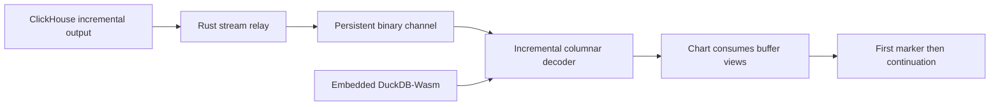

# Streaming from database to canvas without repacking

Status: proposed design, October 9, 2026. This strengthens the architecture around the central requirement: stream useful data all the way into a drawing component without unnecessary copies or whole-result materialization. No implementation or benchmark is implied.

**ClickHouse is the primary intended deployment backend. Embedded DuckDB-Wasm is the first prototype backend.** Both must satisfy the same incremental consumer contract. Native DuckDB inside a Rust service is another useful adapter, not a required intermediate hop or the intended replacement for ClickHouse.

## The preferred data path



The local path has no artificial network step. The service path should relay upstream data with bounded buffering and preserve its encoding when it already matches the negotiated browser format. Do not decode every row into Rust objects merely to serialize them back into Arrow. Authorization, query dispatch, cancellation, status, and small schema/control messages remain separate from the bulk payload.

The first point should not wait for the rest of the result, canvas workspace persistence, another model answer, other cards, tooltips, or an entrance animation. Execution operators that inherently need more input still impose their own dependency; an adapter cannot flush a point the engine has not produced.

## What zero avoidable copy means

The application must account for each allocation, copy, representation conversion, and ownership transfer along the data path. A necessary copy should have an identified boundary and measured byte count; no layer receives a free pass because it calls itself zero-copy.

| Boundary | Desired behavior | What must still be checked |
| --- | --- | --- |
| Database to adapter | Consume the earliest supported batch and retain columnar representation | Engine API may materialize; output formatter may accumulate |
| Rust relay | Forward reference-counted byte chunks or slices without row decoding/re-encoding | Framing/TLS/socket implementations may copy; a buffer abstraction is not a proof |
| Network to browser | Read incrementally and bound outstanding bytes | Browser APIs allocate/expose their own buffers; Rust cannot bypass them |
| IPC decoder | Reuse compatible aligned input buffers as column views | Split chunks, alignment, dictionaries, endian conversion, or compression may require work |
| Worker handoff | Transfer ownership or share explicitly, without structured-cloning large payloads | Backing-buffer aliases, detachment, isolation, and consumer lifetime |
| Optional Rust-Wasm kernel | Process batches already resident in its memory, preferably with fused operations | Importing data from a different Wasm heap can add a copy |
| Chart state | Retain stable batch references and draw ranges | Avoid appending by cloning every previous point on each update |
| GPU | Upload only new/changed display data and update transforms independently | GPU upload and display-specific numeric conversion remain real boundaries |

Arrow's C Data Interface can share buffers between compatible components in one native process. It explicitly does not provide transport across processes or machines; Arrow IPC serves that different purpose. This gives us a useful native integration option, not a claim of an unbroken pointer from ClickHouse's address space into browser GPU memory. [Arrow C Data Interface](https://arrow.apache.org/docs/format/CDataInterface.html).

Do not force a Rust-Wasm stage between the decoder and chart when the chart can already consume its buffers. A Rust-heavy design wins by keeping work and memory together; adding a language boundary for its own sake can move us away from the requirement. See the [Rust/Wasm copy ledger](rust-and-wasm.md).

## The first timestamp must become a visible point

A drawable point requires the timestamp, value, series identity, units/interpretation, and a usable coordinate transform. A timestamp field arriving alone is not enough. Start drawing when that complete dependency set is available; do not wait for full coverage or a complete line.

An Arrow stream is incremental by record batch, and a chosen decoder may expose a batch only after its required metadata, dictionaries, and body are available. That is a potential first-point barrier even if network bytes arrive earlier. Start by comparing the earliest naturally emitted batch and supported fixed-size settings. Where the producer exposes an adaptive-size capability, request a small useful first batch and larger continuation batches; stock engine APIs may not offer that control. A transport chunk is not an Arrow record batch, and neither necessarily equals an engine execution block. [Arrow streaming format](https://arrow.apache.org/docs/format/Columnar.html#ipc-streaming-format).

Benchmark two viable paths:

- **Arrow throughout:** early schema/dictionaries plus the earliest available record batch; test small-first/larger-later production only where supported. Minimize format conversion and keep one decoder.
- **Specialized bootstrap:** a tiny self-contained first-point message, then Arrow bulk data; only if the upstream can expose the point sooner or decoder startup dominates. Account for extraction, duplication, and deduplication cost.

Prefer the first unless measurements justify the second. A custom first-point frame cannot recover time already lost waiting for a large upstream batch. Tune ClickHouse execution/format/HTTP buffering and observe the actual arrival trace before optimizing downstream framing.

Splitting an already encoded Arrow batch into smaller batches in the relay may require decoding/repacking and cannot advance its original availability. An upstream formatter change or a separate bounded first-window query is an explicit experiment, with correctness and snapshot equivalence checked; neither is assumed to be a free socket option.

The chart uses an already-created surface, known time range, and a provisional y-domain where needed. Draw a marker for one point; grow into a line or other representation as more data arrives. A single vertex in a line renderer may produce no visible pixel. Correct point values and evolving axis domains have separate status.

## The chart consumer must actually be incremental

Proposed component interface:

```text
bind(query identity, schema, display contract)
accept(batch handle, byte/column ranges, sequence, quality)
draw(dirty ranges)
finish(coverage, terminal status)
release(batch handle)
```

This is a design sketch, not an API implementation. A batch handle identifies an owned or borrowed buffer plus its lifetime. Control metadata can be small ordinary objects; the numeric columns are not copied into per-row objects. A borrow remains valid until release, including asynchronous rendering that still references it.

Keep immutable batch segments in a bounded collection. Append new segments without repeatedly concatenating all history. Use a cursor/iterator over segments for drawing or upload. Recycle a buffer only once every consumer has released it; otherwise pooling creates data corruption rather than speed. Revisions update affected points/ranges instead of regenerating the entire canvas workspace.

Backpressure runs from retained/rendered buffers through the decoder and relay toward the producer. If the engine cannot pause cheaply, the adapter must use its declared cancellation/resource policy. Do not let the browser accumulate an unlimited result merely because every individual chunk is streamed.

Reserve bounded space and receive credit for completing an admitted IPC message before waiting for that message's release. Otherwise a large incomplete record batch can exhaust credits while the decoder waits for its remaining bytes, producing a deadlock. Negotiate encoded/decoded limits, retain dictionary accounting, and reject oversized messages. The [protocol](protocol.md#flow-control-and-scheduling) specifies the assembly reservation; it permits transport fragmentation without forcing column repacking.

Charts are one consumer. Maps need coordinate columns and a projection; tables need only visible rows initially; photos need a fetched and decoded image. Each card can begin independently. A blank card, empty map, loading thumbnail, or axis scaffold does not count as the corresponding data result. The workspace layout can resemble the reference prototype while each card uses the rendering technology that best suits it.

## Additional approaches worth comparing

1. **Render specification before bulk data.** Infer a small typed card/query intent and prepare its surface while SQL executes. Do not generate arbitrary chart code on the display path.
2. **Separate first data from decoration.** Render points over a prepared background; load map details, legends, and higher-resolution photos independently when their absence does not change interpretation.
3. **Keep columns, move transforms.** Pan/zoom via transform state where possible instead of regenerating every coordinate array. Preserve exact source values for inspection.
4. **Query the visible need.** Fetch the relevant time window, viewport, and resolution; for overview requests use explicit compatible aggregates. Resolution changes must not silently change query meaning or hide extrema.
5. **Keep data handles in workspace state.** Persist chart specifications, query identity, and data references outside the first-point dependency. Avoid repeatedly serializing all rendered rows into chat/workspace history.
6. **Use one representation across consumers.** A chart and table can reference the same accepted batch when their semantics match, rather than each making a private row-object copy.
7. **Reserve a first-result lane.** Give the first useful batch priority over continued photo downloads, bulk chart refinements, and speculative queries at every queue we control.
8. **Retain compatible historical ranges.** On a changed time range, request only missing data when source version and query semantics permit exact reuse; late corrections require invalidation.
9. **Prepare the likely next interaction.** Hover/focus, selected dataset, and current viewport can suggest a bounded prefetch before a follow-up question. Record its hit rate and cost.
10. **Prepare pixels before Enter.** A valid speculative query can stage buffers and possibly a rendered layer. Activation still validates prompt, query interpretation, authority, and data epoch.

Each hypothesis should report first correct draw, completion, peak memory, copied bytes, allocation count, and p95/p99 under contention. A faster tight loop that adds a preceding materialization step fails the architectural goal even if its microbenchmark improves.

## Prototype and service direction

First, prove this path with DuckDB-Wasm and one time-series card. Keep a direct typed-array baseline beside any Rust-Wasm kernel so we can count both work and boundary costs. Add maps, tables, and photos as independent streaming consumers after the shared behavior is clear.

For the usable service, prefer a Rust coordinator with a streaming ClickHouse adapter and persistent browser-compatible transport. Binary WebSocket is the initial comparison baseline; WebTransport is a candidate for independent streams under competing traffic. The choice of socket crate is below these architectural decisions. See [service and channel options](rust-service-and-channels.md).

No application implementation begins as part of this research pass. The outcome is a shortlist of concrete experiments and a stricter representation/streaming contract.
